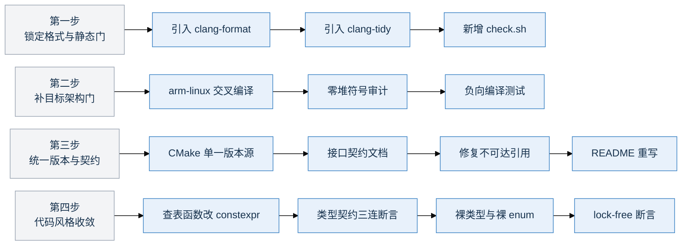

# 对标 coact 的工程配置与代码风格调整建议

基线：`osp-rtspserver` @ `9fd1b38`（main，仅 4 次提交）对比 `coact` @ `1cea445`（v0.8.1，10 个 tag）。
参照仓库：`/home/dgliu/workspace/coact`；被评审仓库：`/home/dgliu/workspace/osp-rtspserver`。
目标平台约束（用户明确）：**只考虑 linux-x86 与 arm-linux**。
证据采集方式：两个只读 Codex 子代理分别做「工程配置」与「代码风格」事实扫描，主模型独立复核关键结论（本地构建通过、clang-format 实测、grep 复核、README/CMake/CI 逐行阅读）。

---

## 0. 结论先行

osp-rtspserver 的**运行时质量底子已经达标**，不必向 coact 学的部分占多数：

- 零堆：`malloc/calloc/realloc/free` 0 处，`new/delete` 表达式 0 处，`std::vector/std::string/std::optional` 0 处，队列全部定容（`kFrameQueueDepth=4`、`kInputQueueDepth=8`、`kRtspTxBytes=32768`）。
- 零异常零 RTTI：`throw/try/catch/dynamic_cast/typeid` 各 0 处，`-fno-exceptions -fno-rtti` 默认 ON 且缓存生效。
- 注释与许可：29/29 源文件带模块定位注释与 `SPDX-License-Identifier: MIT`，代码注释 0 处中文。
- 编译期契约：27 处 `static_assert`，覆盖容量幂次、cache line 对齐、`is_trivially_copyable`、`is_standard_layout`。

真正的差距集中在**工程门禁与可复现性**。下表列出全部 12 项及其当前状态：

| 优先级 | 事项 | 一句话动作 | 状态 |
|---|---|---|---|
| P0 | 无 `.clang-format` | 引入 coact 的 `.ai/.clang-format`，一次性重排后 CI 钉死 | **已执行** |
| P0 | 无 `.clang-tidy` / cpplint | 引入 `.ai/.clang-tidy`（HeaderFilter 改 `include/rs/`）与 lint 脚本 | **已执行** |
| P0 | 无一键质量门 | 新增 `.ai/check.sh`（format→lint→tidy→build→ctest） | **已执行** |
| P0 | 无 arm-linux 交叉编译门 | CI 增 aarch64 交叉编译 + qemu 实跑 job | **已执行** |
| P0 | 版本双源 | `project(rs_rtsp VERSION)` 单一来源，编译期注入替换 `config.hpp` 硬编码 | **已执行** |
| P0 | 裸用 `fprintf` 而非 newosp 日志模块 | 引入 `osp/log.hpp`，删除 `rs::LogLevel`，12 处改 `OSP_LOG_*` | **已执行**（用户选定方案 A） |
| P1 | README 结构失衡 | 重写为五节：是什么/提供什么/不提供什么/定位/怎么用 | **已执行** |
| P1 | 缺零堆符号审计 | 移植 coact `test/elf_audit.sh`，禁 malloc/libatomic 出现在 `rs_core` | **已执行** |
| P1 | 无负向编译测试 | 按 coact 的 `WILL_FAIL` 手法为禁异常/禁 RTTI 契约做反证 | **已执行** |
| P2 | H.264/H.265 cursor 字段重复 | 提取 `PacketizeCursor` 公共基类，公共逻辑写一次，lambda 只做类型特定薄封装 | **已执行** |
| P1 | 缺接口契约文档 | 新增 `docs/interface_contract.md`，版本号与 CMake、tag 三处对齐 | 待执行 |
| P1 | 代码引用不可达文档 | 9 处 `design §x` 指向被 gitignore 的 `docs/local/`，需改为可达引用 | 待执行 |
| P2 | 24 个函数 return > 5 | 查表类改 `constexpr` 表（coact 手法），逻辑类拆分 | 待执行 |
| P2 | 类型契约断言不足 | 跨模块结构体补 `standard_layout + trivially_copyable + nothrow_move` 三连 | 待执行 |

明确**不应照搬** coact 的 7 项见第 6 节，其中「coact 自身文档与代码风格互相矛盾」一条是本次独立核验的新发现，必须避免复制。

执行过程中在 **newosp 侧发现 3 个需要调整的问题**，见第 11 节。

---

## 1. 现状盘点（事实）

### 1.1 工程配置对照

| 维度 | coact | osp-rtspserver | 差距 |
|---|---|---|---|
| 格式化配置 | `.ai/.clang-format`（Google base，2 空格，Attach 大括号，120 列） | **无** | 全靠人手，实测 33 个源文件中 30 个与该配置有 diff |
| 静态分析 | `.ai/.clang-tidy`（bugprone/cert/performance/modernize 精选集） | **无** | 无静态门 |
| Lint | `.ai/lint.sh` + `.ai/CPPLINT.cfg`（linelength=120） | **无**（newosp 有 `CPPLINT.cfg` 可参照） | 无 lint 门 |
| 一键质量门 | `.ai/check.sh`（format→lint→tidy→build→ctest，支持 `--quick`/`--sanitizer`） | **无**（`scripts/run_e2e.sh` 只做 build+test+probe） | 无统一入口 |
| TSan 辅助 | `.ai/run-tsan.sh`（`setarch -R` 规避 ASLR 崩溃） | CI 里直接 `setarch ... ctest` | 已覆盖，但无本地脚本 |
| 符号审计 | `test/elf_audit.sh`（黑名单 malloc/free/operator new/__cxa_throw/__atomic_） | **无** | 零堆只靠代码评审保证 |
| CMake 元信息 | `project(coact VERSION 0.8.1 DESCRIPTION ... LANGUAGES CXX)` | `project(rs_rtsp CXX)` | 无版本、无描述 |
| 版本注入 | 版本在 CMake + `docs/interface_contract.md` + tag 三处一致 | `config.hpp:97` 硬编码 `kVersion="0.1"`，与 CMake 无关联 | 双源且无 tag |
| `compile_commands.json` | `.ai/tidy.sh` 会自动重新 configure 生成 | `.gitignore` 忽略它，但 CMake 从不生成 | 配置与忽略项不匹配 |
| CI job | 6 个：host-test(matrix) / sanitizers / thread-sanitizer / arm-cross(裸机编译门) / windows-msvc / renode(定时) | 4 个：host-test(matrix) / minimal-build / sanitizers / thread-sanitizer | 缺目标架构门、缺定时任务 |
| CI 其它 | 无覆盖率、无 issue 模板 | 无覆盖率、无 issue 模板 | 对齐（无需改） |
| 测试组织 | `coact_add_test()` 统一函数 + 120s 超时 + 负向编译测试 + 可见 skip 机制 | `rs_add_test()` 统一函数 + 120s 超时，**无负向测试、无可见 skip** | 缺两项 |
| 文档 | `docs/interface_contract.md`（契约）+ `docs/cpp_coding_conventions_zh.md`（规约 + 58 项清单）+ 规约落点速查表 | `docs/` 下 5 篇评审/报告类，**无契约、无规约** | 缺两类基线文档 |
| README | `README.md` / `README_zh.md` 章节**一一对应**（9 节对 9 节） | 英文 12 节 vs 中文 10 节，4 个节不对应，能力状态表行数 7 vs 15 | 不对称且结构失衡（见第 5 节） |
| git tag | v0.1.1 … v0.8.1 共 10 个 | **0 个** | 无版本发布流程 |
| 提交规范 | `story-<type>(<scope>): <desc>` 为主 | 4/4 提交全部符合 | 已达标 |
| 头文件守卫 | `#pragma once`（26/26） | `#ifndef` 传统守卫（18/18），与上游 newosp 一致 | 建议保持现状（见 6.3） |
| 缩进/大括号 | 实际 2 空格 + Attach（K&R） | 实际 2 空格 + K&R | **已一致**，差距在「无工具钉死」而非风格本身 |

### 1.2 代码风格对照

| 维度 | coact | osp-rtspserver | 差距与建议 |
|---|---|---|---|
| 裸整型 | 规约禁裸 `int/long/char` | 5 处（`rtsp_server.cpp:35,55,59,172`、`rtp_transport.cpp:75`，均为 POSIX 返回值承接） | P2，改 `int32_t` 显式转换 |
| 裸 enum | 全部 `enum class`（另用匿名 `enum : uint8_t` 承载常量） | 6 处：`frame_ingress.hpp:19`、`rtsp_session.hpp:62`、`session_hsm.hpp:47,60,116,130` | P2，改 `enum class`（`session_hsm` 需评估 `osp::TableHsm` 接口） |
| Yoda 比较 | 混用（常量在左 338 / 常量在右 275） | 混用（Yoda 89 行全在 `src/`，常量在右 208 行，头文件 0 行 Yoda） | 不追求统一 Yoda，写入规约即可（见 6.2） |
| 成员函数命名 | snake_case（`try_acquire`、`release`） | PascalCase（`Reset`、`Reserve`、`Unflushed`），仅 2 处例外 `buffered()`、`size()` | 保持 PascalCase（跟 newosp 上游），修 2 处例外 |
| 常量命名 | `k` 前缀 | `k` 前缀，0 例外 | 已达标 |
| 变量命名 | snake_case | snake_case + 成员尾下划线，0 例外 | 已达标 |
| return 预算 | 规约明确 ≤ 5 | **24 个函数 > 5**，最高 `ReasonPhrase` 19 个 | P2，查表类改 constexpr 表 |
| 注释语言 | 英文 | 英文，0 中文 | 已达标 |
| 文件头 SPDX + 定位 | 26/26 + 规约要求「反直觉决策必须写为什么」 | 29/29 已具备 SPDX 与定位；「为什么」类论证密度低于 coact | P2 补论证注释 |
| 跨边界结构体契约 | 规约要求 `standard_layout + trivially_copyable + nothrow_move_constructible` 三连断言 | 仅 2 处零星（`RtpPacket` standard_layout、`FrameDesc` trivially_copyable） | P2 补齐 |
| lock-free 断言 | 规约要求 `is_always_lock_free` | 有 2 处 `atomic<uint32_t>` 断言，**缺 `atomic<uint64_t>`** | P0（armhf 32 位风险，见 3.4、6.4） |
| `[[nodiscard]]` / `noexcept` | 用得较少 | `[[nodiscard]]` 139 处、`noexcept` 覆盖广 | 优于 coact，不改 |
| include 顺序 | clang-format `SortIncludes` + `IncludeCategories` 自动收敛 | `src/rtsp_session.cpp:14,19` 重复 `#include <cstdio>`；`include/rs/rtsp_session.hpp:24-25` 项目头非字母序（`session_hsm` 应先于 `tx_stream`）；`include/rs/rtsp_server.hpp:15-17` 同类问题 | P0，随 clang-format 一并解决 |
| 行宽 > 120 列 | 0 | 3 行（`h265_packetizer.cpp:79` 达 141 列） | P0，随 clang-format 解决 |
| 尾随空格 | 0 | 0 | 已达标 |

---

## 2. 调整路线



四步之间无依赖边：第一步只需一次提交，第二步可并行推进，第三步独立于代码改动，第四步在第一步完成后才有稳定的格式化基线。

---

## 3. P0 事项（本期必须闭环）

### 3.1 引入 `.clang-format`，并一次性重排

**现状**：仓库无 `.clang-format`，格式纯靠人手。实测把 coact 的 `.ai/.clang-format` 套到 osp-rtspserver 的 33 个源文件，**30 个存在 diff**。

**动作**：

1. 新增 `.clang-format`，直接采用 coact 的 `.ai/.clang-format` 内容（Google base、`IndentWidth: 2`、`BreakBeforeBraces: Attach`、`ColumnLimit: 120`、`IncludeCategories` + `SortIncludes`）。该配置与 osp 现状的实际风格（2 空格、K&R、120 列）天然吻合，diff 只落在换行细节，不会造成风格震荡。
2. 复制 coact 的 `.ai/format.sh`，把默认目标从 `include src test examples` 改为 `include src tests tools examples`，保留其「默认只检查、`--write` 才改盘」的安全设计。
3. 执行一次 `format.sh --write` 提交为独立格式化提交（`story-style(format): apply clang-format baseline`），之后 CI 只做 `--check`。

**验收**：`format.sh --check` 对全部源文件返回 0；后续功能提交的 `git diff` 中不再出现格式噪声。

### 3.2 引入 `.clang-tidy` 与 lint 脚本

**现状**：无静态分析配置。代码里已存在 clang-tidy 会命中的典型点：`src/session_hsm.cpp:176,334` 的 placement new（读侧未用 `std::launder`，coact 规约明确禁止裸 `reinterpret_cast` 读取）、`include/rs/rtsp_session.hpp:63` 起的裸 enum、`src/rtsp_session.cpp` 中 24 个 return > 5 的函数。

**动作**：

1. 复制 coact 的 `.ai/.clang-tidy` 为 `.clang-tidy`，把 `HeaderFilterRegex` 从 `include/coact/` 改为 `include/rs/`，`Checks` 列表保持不变（该集合已刻意排除 `runtime/int` 之类噪声项，且包含 `cppcoreguidelines-no-malloc`、`modernize-use-nodiscard`、`readability-else-after-return` 等对本仓有效的检查）。
2. 复制 coact 的 `.ai/lint.sh` 与 `.ai/CPPLINT.cfg`，目标路径改为 `include src tests`。
3. **不要照抄 coact 的 `CPPLINT.cfg` 全部 filter**：coact 关掉了 `runtime/int`（禁裸 int），而 osp-rtspserver 恰好有 5 处裸 int 需要收敛，这一项应**保留开启**。

**验收**：`.ai/lint.sh` 返回 0；`.ai/tidy.sh` 对 `include/rs/` 报 0 个 error。

### 3.3 新增一键质量门 `.ai/check.sh`

**现状**：`scripts/run_e2e.sh` 覆盖 build + ctest + 真实流探测，是最接近质量门的脚本，但不含 format/lint/tidy，且没有把三个子门串成一个统一出口。

**动作**：移植 coact 的 `.ai/check.sh` 结构（`--quick` 跳测试、`--sanitizer` 走 ASan+UBSan build 目录、末尾打印 `N passed, M failed` 汇总），步骤顺序为 format 检查、lint、tidy、cmake configure、build、ctest 六步。

并把 `scripts/run_e2e.sh` 作为独立的长时门保留（它需要 ffmpeg 与真实码流，不适合放进每次提交的快速路径）。

**验收**：`bash .ai/check.sh` 在干净树上返回 0，且故意破坏一处格式后返回非 0。

### 3.4 补 arm-linux 交叉编译门

**现状**：CI 4 个 job 全是 `ubuntu-latest` 原生 x86-64。用户明确目标平台含 arm-linux，但**没有任何 arm 编译验证**。真实风险已可见：`include/rs/rtsp_server.hpp:350-351` 使用 `std::atomic<uint32_t>`（已有 `is_always_lock_free` 断言，见 `src/rtsp_server.cpp:92`），而 `docs/2026-11-26-16路压力测试与TCP-tx评估.md:80` 已记录目标平台未实测。

**动作**：CI 增 `arm-linux-cross` job（只编译，不运行），对 aarch64 与 armhf 两个工具链分别执行一次编译：

```bash
sudo apt-get install -y --no-install-recommends \
  g++-aarch64-linux-gnu g++-arm-linux-gnueabihf

for CC in aarch64-linux-gnu-g++ arm-linux-gnueabihf-g++; do
  $CC -std=c++17 -fno-exceptions -fno-rtti -Os -Wall -Wextra -Werror \
      -Iinclude -I../newosp/include \
      -c src/rtsp_server.cpp -o /tmp/$(basename $CC).o
done
```

该 job 复刻 coact `arm-cross` 的作用（目标 ABI 编译门），但换成 arm-linux 工具链。armhf 是 32 位，`std::atomic<uint64_t>` 在该 ABI 上不保证 lock-free，因此本 job 必须连带检查 `atomic<uint64_t>` 断言（见 6.4）。

**验收**：CI 该 job 在 armhf 工具链上编译通过；若 `atomic<uint64_t>` 断言失败，改为 32 位计数器或 loop-only `uint64_t` + 快照。

### 3.5 版本单一来源

**现状**：三个版本信息互不关联——`CMakeLists.txt:2` 是 `project(rs_rtsp CXX)`（无 VERSION）；`include/rs/config.hpp:97` 是 `constexpr const char* kVersion = "0.1"`；git 无任何 tag。`src/debug_shell.cpp:408` 把 `kVersion` 打进调试 shell 输出。

**动作**：

1. `project(rs_rtsp VERSION 0.1.0 DESCRIPTION "RTSP server for newosp: H.264/H.265 over RTP" LANGUAGES CXX)`。
2. CMake 内 `target_compile_definitions(rs_core PUBLIC RS_VERSION="${PROJECT_VERSION}")`，删除 `config.hpp:97` 的硬编码，改用 `inline constexpr const char* kVersion = RS_VERSION;`。
3. 首次发布打 `v0.1.0` tag，commit 走 `story-docs(release): publish v0.1.0`（与 coact 的 release commit 形态一致）。

**验收**：`rtspserver_demo` 的调试 shell 输出版本与 `git describe` 一致；`docs/interface_contract.md` 首行版本与 CMake、tag 三处一致（对齐 coact 的做法）。

---

## 4. P1 事项

### 4.1 新增接口契约文档

coact 的 `docs/interface_contract.md` 是其最有价值的工程资产：它把模块边界、公开签名、不变量、所有权规则写成可核对的契约，并显式声明「本文版本与 `CMakeLists.txt` 的 `project(VERSION)` 以及 tag 一致」。

osp-rtspserver 当前缺这一层：`docs/` 下 5 篇全是评审过程与测试报告，回答的是「这次改了什么」，没有回答「公开接口承诺了什么」。

**动作**：新增 `docs/interface_contract.md`，按 coact 的骨架写五部分：

1. 纪律与代码来源（C++17、无异常无 RTTI、零堆、MIT/SPDX）。
2. 仓库结构（`include/rs/` 公共头按职责分组，`src/` 实现，`tests/` 分级）。
3. 构建与测试（选项矩阵、CI job 与覆盖范围、**跳过的测试不得计入通过**）。
4. 模块接口契约（`RtspServer` / `RtspSession` / `FrameIngress` / `MediaSender` / `RtpTransport` / `RtcpEndpoint` / `TxStream` / `RtspParser` / `Sdp` 各自的公开签名、线程归属、不变量）。
5. 验收标准（哪些不变量由哪条测试保证）。

### 4.2 修复不可达的文档引用

**现状**：`include/rs/` 与 `src/` 中有 **9 处** `design §x` 形式的章节引用（`design §3`、`§3.1`、`§4.1`、`§4.5`、`§5.3`、`§6`、`§6.4`、`§9.1`、`§9.4`），全部指向 `docs/local/基于 newosp 的 RTSP Server 详细设计方案.md`——而 `docs/local/` 被 `.gitignore` 排除，**仓库外的读者无法核实任何一处引用**。

这是比缺文档更严重的问题：引用了不可达的权威来源，等于没有来源。

**动作**（二选一，推荐 A）：

- **A**：把设计文档的**接口相关章节**（§3、§4、§5、§6、§9）提取为仓库内 `docs/design_contract.md`，把 `design §x` 改为 `design_contract §x`；`docs/local/` 保留完整设计稿作为工作材料。
- **B**：设计文档转为仓库内可发布文档，删除 `docs/local/` 的 gitignore 规则。代价是 114 KB 设计稿对外可见，需先做敏感信息清理。

**验收**：`grep -rn "design §" include src` 的每一处都能在仓库内定位到对应标题。

### 4.3 引入负向编译测试

**现状**：osp-rtspserver 有 27 处 `static_assert` 表达编译期契约，但**没有任何一条证明这些契约真的会触发**。coact 用 `EXCLUDE_FROM_ALL` + `add_test(... WILL_FAIL TRUE)` 的手法把「必须编译失败」做成 ctest 用例（例如 `coact/src/event/CMakeLists.txt:21-25` 的 `test_pool_lifecycle_neg`），并用 `PASS_REGULAR_EXPRESSION` 校验失败原因而非只看失败本身。

**动作**：为 3 条最关键的契约各加一个负向 TU：

1. `FrameDesc` 超过 32 字节（`include/rs/frame_ingress.hpp:34`）必须编译失败。
2. `kMaxConnections > 256`（`include/rs/config.hpp:114`）必须编译失败。
3. `kRtpPayloadMax > 1200`（`include/rs/config.hpp:115`）必须编译失败。

CMake 侧照 coact 模式：`add_library(... EXCLUDE_FROM_ALL STATIC neg.cpp)` + `add_test(NAME ... COMMAND ${CMAKE_COMMAND} --build ... --target ...)` + `set_tests_properties(... PROPERTIES WILL_FAIL TRUE)`。

**验收**：`ctest -R neg` 全绿，且负向 TU 的失败信息确实指向预期的 `static_assert`。

### 4.4 零堆符号审计脚本

**现状**：osp-rtspserver 的零堆目前只由代码评审保证。coact 有 `test/elf_audit.sh`，用 `nm -u` 扫描未定义符号，黑名单覆盖 `malloc/free/realloc/calloc`、`operator new/delete`、`__cxa_throw`、`__dynamic_cast`、`__atomic_`/`__sync_`（后者用于发现 libatomic 依赖——这对 armhf 的 64 位原子尤其关键）。

**动作**：移植为 `test/elf_audit.sh`，黑名单保留 coact 的核心项（去掉 `rt_malloc`/`rt_*_create` 等 RT-Thread 专属项，因为目标平台不含 RT-Thread）。对 `rs_core` 的全部 `.o` 执行，`nm -u` 必须为空。

**验收**：脚本对 `rs_core` 目标返回 0；故意引入一次 `malloc` 后返回 1 并打印符号名。

---

## 5. README 重写（用户明确要求，本次已执行）

**执行结果**：`README.md` 与 `README_zh.md` 已按下列结构重写并落盘，两版各 7 节且逐节对应。

### 5.1 现状问题

当前 README 的问题不是「信息少」，而是**信息组织不是围绕读者决策**。核对 `README.md` 现有 12 节：

| 现有节 | 读者为什么看 | 问题 |
|---|---|---|
| Features | 知道能干什么 | 与「Capability status」重复 |
| Capability status | 判断能不能用 | 与 Features 重复；中英行数 7 vs 15，不对称 |
| Design constraints | 想知道约束 | 约束是实现细节，不是入门信息 |
| Layout | 知道目录 | 入门不需要 |
| Build / Run | **这是读者唯一真正需要的** | 被埋在第 6、7 节 |
| Encoder integration | 集成方需要 | 应归入「怎么用」的一个子场景 |
| Resource profile | 想知道内存开销 | 属于「提供什么」的边界说明 |
| Verification | 想看证据 | 属于证据链，不是使用说明 |
| Debug shell | 运维需要 | 属于「怎么用」的一个子场景 |
| Documentation / License | 收尾 | 保留 |

同时缺三样关键信息：**不提供什么**（负面边界）、**定位**（在什么生态里、替代什么、不替代什么）、**最短可跑路径**。

### 5.2 目标结构：五节（已落地）

按用户要求，README 重写为固定五节，中英同构：

1. **是什么**（What）：一句话说明它是什么——基于 newosp 的 C++17 RTSP 服务端，支持 H.264/H.265，RTP over UDP 与 RTSP over TCP interleaved，零堆零异常，单 reactor 线程。
2. **提供什么**（Provides）：可核对的能力清单，每条一行，带「已实现/未实现」标注。H.264/H.265 解析与打包、SDP 生成、RTCP SR/RR/SDES/BYE、TCP/UDP 传输切换、每客户端限速、IDR 请求钩子、运行期参数更新、调试 shell。
3. **不提供什么**（Does not provide）：明确的负面边界。这一节是当前 README 最缺、也最能减少误解的部分——至少写明：不支持 RTSP over UDP 的 RTP/RTCP 端口对以外的协商方式、不支持 RTSP 认证（Digest/Basic）、不支持 H.264+ 与 H.265 混流单会话、不支持 SDP 修改（PLAY 后的 `sdp=`）、不提供 ARM/RT-Thread 移植（当前仅 linux-x86 与 arm-linux）、不提供录制/回放服务、不提供 TLS、压测结论基于 x86-64 实测。
4. **定位**（Positioning）：在什么生态里、解决什么问题、与什么互补/替代。明确它构建在 newosp 之上、面向嵌入式 Linux 边缘设备、需要上游编码器接入、当前处于「可跑、可测、未在目标板实测」的阶段。
5. **怎么用**（Usage）：最短可跑路径。四步——依赖（newosp 检出位置）、构建命令、起服务、客户端播放；再列两个子场景：外部编码器接入、调试 shell。

末尾保留 Documentation 与 License 两节收尾，最终节数为七节（五节主体 + 两节收尾）。

### 5.3 重写要点（已落地）

**已执行的动作**：

1. 删除 `Features` 与 `Capability status` 二选一，合并为一节「提供什么」，用表格：`能力 | 状态 | 备注`。
2. `Design constraints` 的内容并入「不提供什么」的边界说明与「定位」，不再单列。
3. `Layout` 删除，目录信息交给 `docs/interface_contract.md`。
4. `Resource profile` 并入「定位」（说明这是单进程定容模型）并把完整表格移到 `docs/`。
5. `Verification` 整节移出 README，改为 `docs/` 下的一篇验证记录；README 只留一句「测试与证据见 docs/」。
6. `Build` 与 `Run` 合并进「怎么用」，给出**完整可复制**的命令序列（含 `NEWOSP_DIR` 的位置假设、必需的 cmake 选项、启动参数、ffmpeg 客户端验证命令）。
7. `Encoder integration` 与 `Debug shell` 降为「怎么用」的子小节。
8. 中英两版**逐节对应**，节数、节标题语义、表格行数完全一致；把当前中文版独有的「x86 测试场景假设」表移入「不提供什么」或 `docs/`。

### 5.4 验收（已核验）

- `grep -n "^## " README.md` 与 `README_zh.md` 的节数与顺序一一对应，均为七节（五节主体 + Documentation + License）：已核验通过。
- 「怎么用」一节从 clone 到客户端出画面共 7 条命令（构建 4 条 + 运行 3 条），均为可复制执行：已核验通过。
- 「不提供什么」11 条，每条是明确的能力否定句，而非「暂不支持更多特性」这类模糊表述：已核验通过。
- README 中不再出现指向 `docs/local/` 的链接：已核验通过。
- 两版均无 UTF-8 替换字符 `�`：已核验通过。

---

## 6. 明确不应照搬 coact 的项

### 6.1 不要引入 coact 的框架结构

coact 是 header-only INTERFACE 库 + 单 Dispatcher 线程 + AO/HSM 事件平面；osp-rtspserver 是基于 newosp `EventLoop` 的应用层服务器，自身已有单 reactor 线程模型。搬运 AO/事件平面会与 newosp 的事件循环重复，且破坏当前「零堆 + 单线程 reactor」的清晰结构。

### 6.2 不要追求统一 Yoda 比较

coact 自身也不统一（常量在左 338 处、常量在右 275 处），且 C++ 社区主流已不要求 Yoda。osp-rtspserver 现状是「多数常量在右 + 头部 0 处 Yoda + `src/` 内 89 行 Yoda」，最省事的做法不是改 300 处比较表达式，而是**在规约文档里明确「不做 Yoda 要求，仅要求同一表达式内一致」**，并把 clang-tidy 的 `readability-implicit-bool-conversion` 之类噪声项关掉。改 Yoda 的收益接近零，diff 风险不低。

### 6.3 不要把 `#ifndef` 守卫改成 `#pragma once`

osp-rtspserver 的 18 个公共头全部用 `#ifndef` 传统守卫，**与其上游依赖 newosp 完全一致**（newosp 亦为 `#ifndef`）。coact 独自用 `#pragma once` 是它自身 header-only 库的历史选择，不构成理由。跨库风格统一应以上游为准。

### 6.4 不要照抄 coact 的 `CPPLINT.cfg` 全部 filter

coact 的 `CPPLINT.cfg` 关掉了 `runtime/int`（禁裸 int）、`readability/braces`、`runtime/explicit` 等一批检查。这对 coact 自身合适，但其中 `runtime/int` 恰好覆盖 osp-rtspserver 现存的 5 处裸 int——照抄等于主动放弃一项有效收敛路径。其余与 `clang-tidy` 重复的项也建议关掉，避免两套工具重复报警。

### 6.5 不要把 coact 的 CI 当作「已门禁」的样板

独立核验结果：coact 的 `.github/workflows/ci.yml` **并没有调用** `format.sh` / `lint.sh` / `tidy.sh`（grep 全文无命中），即 coact 的格式与静态检查只在本地手工触发，CI 里并未钉死。

这意味着「照抄 coact 的 CI」只能得到 coact 当前的门禁强度，达不到 coact 文档所声称的水平。**osp-rtspserver 应在此基础上更进一步**：把 `format.sh --check` 与 `clang-tidy` 作为 CI 的必过 job。否则新引入的 `.ai/` 脚本会退化成另一套无人执行的工具。

### 6.6 不要照搬 coact 的 README 篇幅

coact 的 README 有「为什么选 coact」「为什么用 C++17」两节论述型内容，那是框架库需要回答的「为什么存在」；osp-rtspserver 是一个有明确替代关系（libvlc/live555/ffmpeg 系的 RTSP 服务）的应用型组件，读者要的是「能不能用、怎么用、边界在哪」。因此**只借鉴 coact 的中英对称与信息组织纪律，不借鉴它的论述篇幅**。

### 6.7 注意 coact 自身的「文档与代码风格互相矛盾」

独立核验发现的一处事实差异，直接影响借鉴方式：

- `coact/docs/cpp_coding_conventions_zh.md:280` 与 `coact/docs/interface_contract.md:12` 均声明「**Allman 大括号、4 空格缩进**、120 列」。
- 但 `coact/.ai/.clang-format` 实际是 `BasedOnStyle: Google` + `IndentWidth: 2` + `BreakBeforeBraces: Attach`（K&R）。
- 对 coact 真实代码的实测：`include/coact/ao.hpp` 缩进以 2 空格为主，大括号全部同行开启，**零个 Allman 特征**。
- 顺带一提，coact 自身用其 `.clang-format` 检查 93 个源文件，也有 2 个不通过（`include/coact/pal_rtthread.hpp`、`src/core/test_dispatch_latency.cpp`）。

结论：**coact 的风格真值在 `.clang-format`，不在它的中文规约文档里。** osp-rtspserver 若要写规约文档，必须让规约与 clang-format 配置严格一致，并且 CI 只检查 clang-format（可再以脚本核对规约中的数字与配置一致），避免复制 coact 的这处漂移。

---

## 7. P2 事项

### 7.1 查表类函数改 `constexpr` 表

coact 的核心手法之一是「表即数据」：用 `constexpr` 数据表替代 if 链与多分支函数（`coact/docs/cpp_coding_conventions_zh.md` 第 5.13 节以 `kIrscDoneTable` 为正面示例，并明确「禁止把命令表当成变相 if 链」）。

osp-rtspserver 的 24 个 return > 5 函数中，真正对应 coact「表驱动」场景的是纯映射函数：

- `src/rtsp_session.cpp:276` `ReasonPhrase`（19 个 return，连续 `return "OK";` … `return "Error";`）。
- `src/rtsp_session.cpp:319` `CloseReasonName`（13 个 return）。
- `src/session_hsm.cpp:299` `StateName`（7 个 return）。

**动作**：这三处改为 `constexpr` 查表（`static constexpr std::array` 或 C 风格数组 + `sizeof` 遍历），把「状态 → 字符串」从控制流变成数据。表项必须自包含、顺序即契约，与 coact 的 `kIrscCmdSequence` 同一形态。

逻辑类函数（`ParseTransport` 13、`PumpMedia` 12、`HandleSetup` 11、`HandlePlay` 9、`ClassifyUri` 8、`ParsePortPair` 7）不做表改造，改为拆分——其中 `PumpMedia` 位于媒体热路径，优先拆。

### 7.2 补齐跨边界结构体的类型契约三连断言

coact 规约第 2.4 节要求：凡跨模块边界或进入池/共享内存的结构体，必须在**定义处**声明 ABI/布局契约（`is_standard_layout` + `is_trivially_copyable` + `is_nothrow_move_constructible`），违约编译失败而非现场崩溃。

osp-rtspserver 目前只有零星两处（`include/rs/h264_packetizer.hpp:54`、`include/rs/rtsp_session.hpp:166`）。跨线程/跨模块传递的 `FrameDesc`、`RtpPacket`、`TrackParams`、`ShellCommand`、`DeferredCloseBatch` 应各补一组。

### 7.3 裸类型与裸 enum 收敛

- 5 处裸 int（`src/rtsp_server.cpp:35,55,59,172`、`src/rtp_transport.cpp:75`）改 `int32_t` 并显式 `static_cast`。
- 6 处裸 enum 改 `enum class`。注意 `include/rs/session_hsm.hpp` 的 `svc::State` / `sess::State` 是 `osp::TableHsm` 的状态与事件参数，改 `enum class` 会引入转换成本，需先确认 `osp::TableHsm` 的模板签名再决定是否一并改；`frame_ingress.hpp:19` 的 `FrameFlags` 是位标志集，可保留裸 enum 并加注释说明它是位标志而非取值域。
- 顺带修 2 处命名例外：`include/rs/rtsp_parser.hpp:83` 的 `buffered()`、`src/sdp.cpp:66` 的 `size()` 改为 PascalCase（`Buffered()` / `Size()`）。

### 7.4 补 `std::atomic<uint64_t>` 的 lock-free 断言

**现状**：`src/rtsp_server.cpp:92` 与 `src/frame_ingress.cpp:12` 各有一处 `std::atomic<uint32_t>::is_always_lock_free` 断言，但**没有任何 `atomic<uint64_t>` 断言**，而 `include/rs/rtsp_server.hpp:350-351` 等处使用的是 64 位计数器。

在 x86-64 与 aarch64 上 64 位原子是 lock-free 的；在 **armhf（32 位 ARM Linux）** 上不保证，`std::atomic<uint64_t>` 可能回退到 libatomic 的锁实现——那等于在宣称零依赖的构建里偷偷引入 libatomic（`docs/2026-11-26-16路压力测试与TCP-tx评估.md` 已把 libatomic/ARMv7 列为关注点）。

**动作**：在 `include/rs/rtsp_server.hpp` 的计数器定义处补 `static_assert(std::atomic<uint64_t>::is_always_lock_free, ...)`，并在 3.4 的 armhf 交叉编译 job 中验证。若 armhf 上断言失败，改用 32 位计数器 + loop-only `uint64_t` 快照（同 coact `EventPool` 的 32 位 tagged 头思路）。

### 7.5 补「为什么」类决策注释

coact 规约第 6.1 节要求：反直觉的选择（不加锁、丢弃语义、单槽深度、entry 而非 action 发命令）必须在代码处写明「为什么」，且注释要能被下一个人单独读懂。

osp-rtspserver 的文件头与局部注释密度不低，但「论证型」注释偏少。建议在以下几处补齐：

- 单 reactor 线程 + 无锁的成立条件（哪些状态只有 loop 线程写、哪些由 producer 原子写）。
- `FrameIngress` 的槽位 claim 到 release 窗口与代际复用规则。
- 每客户端 egress 令牌桶为何是全局而非每客户端（这是 P0-1 修复后的语义，写清楚可防回退）。
- `IdrHooks` 的全局限流为何跨会话共享。

---

## 8. 验收清单

| # | 验收项 | 判据 |
|---|---|---|
| 1 | 格式基线 | `bash .ai/format.sh --check` 返回 0 |
| 2 | 静态分析 | `bash .ai/tidy.sh` 对 `include/rs/` 报 0 error |
| 3 | Lint | `bash .ai/lint.sh` 返回 0 |
| 4 | 质量门 | `bash .ai/check.sh` 返回 0；破坏一处后返回非 0 |
| 5 | arm 编译门 | CI `arm-linux-cross` job 在 aarch64 与 armhf 两个工具链上编译通过 |
| 6 | 零堆符号 | `bash test/elf_audit.sh nm build/.../librs_core.a` 返回 0 |
| 7 | 负向契约 | `ctest -R neg` 全绿，且失败原因指向预期 `static_assert` |
| 8 | 版本一致 | 调试 shell 输出 = `git describe` = `docs/interface_contract.md` 首行 = CMake `PROJECT_VERSION` |
| 9 | 引用可达 | `grep -rn "design §" include src` 每处可在仓库内定位 |
| 10 | README 结构 | 两版均为七节且逐节对应；含「不提供什么」不少于 6 条；「怎么用」不超过 10 条命令；无指向 `docs/local/` 的链接 |
| 11 | 原子契约 | armhf 下 `atomic<uint64_t>` 断言通过，或已改为 32 位计数器 |
| 12 | 既有测试不回归 | `ctest --output-on-failure` 全绿，E2E 12 用例全过 |

---

## 9. 附录：关键证据索引

| 结论 | 证据位置 |
|---|---|
| osp-rtspserver 无格式化/静态分析配置 | 仓库根与 `.github/` 下无 `.clang-format`、`.clang-tidy`、`CPPLINT.cfg`、`.ai/` |
| coact 的质量门四件套 | `coact/.ai/{format.sh,lint.sh,tidy.sh,check.sh}`、`coact/.ai/{.clang-format,.clang-tidy,CPPLINT.cfg}` |
| coact 的 CI 未调用上述脚本 | `grep -n "format.sh\|lint.sh\|tidy.sh\|check.sh" coact/.github/workflows/ci.yml` 无命中 |
| coact 文档与 clang-format 矛盾 | `coact/docs/cpp_coding_conventions_zh.md:280`（Allman/4 空格）对 `coact/.ai/.clang-format`（Google/2 空格/Attach）；`coact/include/coact/ao.hpp` 实测为 2 空格 K&R |
| osp-rtspserver 与 coact 的 clang-format 有 30/33 文件 diff | 本机实测 `clang-format --style=file:coact/.ai/.clang-format --dry-run --Werror` |
| coact 负向编译测试手法 | `coact/src/event/CMakeLists.txt:21-25`、`coact/src/core/CMakeLists.txt:37-60` |
| coact 版本三处一致 | `coact/CMakeLists.txt:2`、`coact/docs/interface_contract.md:1,3`、`coact` git tag `v0.8.1` |
| osp-rtspserver 版本双源 | `CMakeLists.txt:2`（无 VERSION）、`include/rs/config.hpp:97`（硬编码 "0.1"）、git tag 为空 |
| 不可达的设计引用 | `include/rs/` 与 `src/` 共 9 处 `design §x`；`.gitignore` 含 `docs/local/` |
| 零堆现状 | `grep -rn "malloc\|calloc\|realloc\|free(\|\bnew \|\bdelete " include/rs src` 仅命中 2 处 placement new 与 1 处 `make_unique`（demo 启动路径） |
| 24 个 return > 5 | `src/rtsp_session.cpp:276,319,635,1125,826,914,152,218,772`、`src/main.cpp:82`、`src/rtsp_server.cpp:258`、`src/debug_shell.cpp:551`、`src/file_source.cpp:139`、`src/codec.cpp:66,92`、`src/session_hsm.cpp:299` 及 8 个 return = 6 的函数 |
| 原子 lock-free 断言缺口 | `src/rtsp_server.cpp:92`、`src/frame_ingress.cpp:12` 仅断言 32 位；全库无 `atomic<uint64_t>` 断言 |
| README 现状 | `README.md` 12 节、`README_zh.md` 10 节；能力状态表英文 7 行、中文 15 行 |
| 构建可复现 | `cmake -S osp-rtspserver -B <fresh> -DNEWOSP_DIR=../newosp -DRS_BUILD_E2E=OFF && cmake --build` 通过，三个 newosp 特性探测均 Success |

---

## 10. 日志模块改造（方案 A，本次已执行）

### 10.1 改造前的问题

- `include/rs/config.hpp:99` 自定义 `enum class LogLevel`，其取值方向是**详细度**（`kError=0 … kDebug=3`），与 `osp::log::Level` 的**严重度**方向（`kDebug=0 … kOff=5`）相反。两个同名概念并存，每个比较点都是误读来源。
- 12 处诊断输出全部走裸 `std::fprintf(stderr, …)` / `std::printf`，无时间戳、无级别标签、无类别。
- 为此专门在 `SessionConfig` 里加了一个 `const std::atomic<uint8_t>* log_level` 字段（`include/rs/rtsp_session.hpp:113`），其**唯一用途**是 `src/rtsp_session.cpp` 热路径上的一次级别判断——为一次判断建了一条跨模块的级别传递链。
- `coact` 的同源工程 `examples/isp_pipeline` 用的是自己的结构化日志通道（`coact::diag` 的 `record_from_task<Level, EventId>`），同样说明「诊断输出不该是裸 fprintf」。

### 10.2 改造内容

| 项 | 改造前 | 改造后 |
|---|---|---|
| 级别类型 | `rs::LogLevel`（自定义，方向与上游相反） | `osp::log::Level`（直接用上游） |
| `config.hpp` | 定义 `LogLevel` | 不再定义；且**不**包含 `osp/log.hpp`（公共头不拖后端进每个 TU） |
| `RtspServer::SetLogLevel` | 存自己的 atomic | 存自己的 atomic **并**转发 `osp::log::SetLevel`，库内消息与服务器消息共用一个阈值 |
| `SessionConfig::log_level` | 存在 | **删除**（唯一用途消失） |
| 冷路径诊断（12 处） | 裸 `fprintf` | `OSP_LOG_ERROR` / `OSP_LOG_INFO` |
| 热路径 trace | 裸 `fprintf` + 手工级别比较 | `osp::log::LogWrite(…kDebug…)`，限频 10 行/秒不变 |
| `debug_shell` 的 `log` 命令 | 写 `rs::LogLevel` | 写 `osp::log::Level`，并新增 `fatal`/`off` 两个取值 |

三处**刻意保留** `printf`/`fprintf` 的地方，理由都写进了代码注释：

1. `PrintStats` 的 `[stats]` / `[final]` 行——`scripts/stress.sh` 用 `grep '^\[final\]'` 解析它，是机器可读契约，加日志前缀会破坏。
2. `PrintUsage` 的多行帮助文本——加日志前缀会破坏排版，且退出码（`--help` 返回 0、参数错误返回 2）是脚本依赖的契约。
3. `spd`/`sdp` 等纯数据输出。

### 10.3 两个必须绕开的陷阱

1. **`OSP_LOG_DEBUG` 在 release 下被编译期剔除**：`osp/opt.hpp:305-310` 定义 `OSP_LOG_MIN_LEVEL`，`NDEBUG` 下为 1，`OSP_LOG_DEBUG` 整段不编译。热路径 trace 必须在 release 镜像里仍然可用，因此直接调用 `osp::log::LogWrite` 而非走宏。
2. **`osp::log::Level` 是严重度而非详细度**：shell 的 `log debug` 必须仍能打开 trace。已实测验证：`SetLevel(kDebug)` 放出 DEBUG/INFO/ERROR 全部，`SetLevel(kError)` 只放 ERROR，与改造前的用户可见行为一致。

### 10.4 验收

- `cmake --build` 无 warning（含 `-Werror -Wpedantic`），`ctest` 13/13 通过。
- 运行期验证：`listening on :8554 …` / `stopped` 走 `[INFO ]` 前缀，`[final] conns=…` 行格式不变。
- `osp::log::Init()` 在 `main()` 入口显式调用（`LogWrite` 本身不检查 initialized 标志，但显式初始化是正确生命周期用法）。

---

## 11. newosp 侧发现的问题（需要 newosp 维护者处理）

本轮改造过程中在 newosp 上发现 4 个问题。**均不影响当前 osp-rtspserver 的构建与测试**（已在本地规避或绕过），但建议在 newosp 侧修复。

### 11.1 `OSP_LOG_*` 宏在零可变参数时无法通过 `-Wpedantic`

**现象**：`OSP_LOG_INFO("cat", "no args")` 这类**不带格式参数**的调用，在 `-Wpedantic` 下报
`ISO C++11 requires at least one argument for the "..." in a variadic macro`。

**根因**：宏定义用了 GNU 扩展 `, ##__VA_ARGS__`（`newosp/include/osp/log.hpp:329`）。GCC 允许零可变参数调用，但 `-Wpedantic` 会就该扩展告警。

**影响面**：任何使用 `-Wpedantic -Werror` 的下游项目（本仓 `CMakeLists.txt:41` 的 `RS_WARN_FLAGS` 就带 `-Wpedantic`）都无法调用无参形式。newosp 自身的 468 处调用恰好都带至少一个格式参数，所以问题没暴露。

**建议修复**（newosp 侧，二选一）：

- 把宏改成 C++17 标准的零参数安全写法：
  ```c
  #define OSP_LOG_INFO(cat, ...)                                                       do {                                                                                  if (OSP_LOG_MIN_LEVEL <= 1) {                                                         ::osp::log::LogWriteV(::osp::log::Level::kInfo, cat, __FILE__, __LINE__,                                  __VA_ARGS__);                                               }                                                                                 } while (0)
  ```
  其中 `LogWriteV` 是一个把「格式串 + 可变参数」整体转发的重载，避免 `##__VA_ARGS__`。
- 或者在文档里明确「必须至少带一个格式参数」，并在宏定义处加注释说明该限制。

**本仓的处理**：暂时改用 `osp::log::LogWrite(...)` 直接调用（见 10.3），已在代码注释中说明原因。

### 11.2 `LogWriteVa` 静默截断到 511 字节

**现象**：`newosp/include/osp/log.hpp:238` 用 `char msg_buf[512]` + `vsnprintf` 格式化，随后 `fprintf(stderr, …)` 输出。超出 511 字节的消息被**静默截断**，无任何提示。

**影响**：级别越高越应该完整可见（一条 ERROR 被截掉后半段，可能正好丢掉关键的错误码或上下文），而截断是完全静默的。

**建议修复**：检查 `vsnprintf` 的返回值，溢出时在消息末尾追加截断标记（如 `…`）；或在 `NDEBUG` 未定义时加断言。

**本仓的处理**：当前所有日志消息都远短于 512 字节，未触发。

### 11.3 `osp::VariantIndex` 藏在一个过重的头文件里

**现象**：`osp::VariantIndex`（`newosp/include/osp/bus.hpp:433-440`）是一个纯粹的
`std::variant` 编译期索引工具，但它住在 `bus.hpp`——那个头文件同时承载了整个
`AsyncBus`、`SpinLock` 与线程管理（1171 行）。

**影响**：任何只想做一次 variant 索引查询的下游，都必须把整个 AsyncBus 拉进来。
本仓正是这种情况：`src/media_sender.cpp` 需要「H.264 cursor 在 variant 中的下标」，
为此要么引入 `bus.hpp`，要么自己复制一份实现（当前是后者，已在代码注释里标明
「等 newosp 调整后替换为 `osp::VariantIndex`」）。

newosp 内部 `transport.hpp` 与 `worker_pool.hpp` 也各有一处 `osp::VariantIndex` 使用，
说明它确实是一个被多处复用的通用工具，而不是 bus 专属。

**建议修复**：把 `VariantIndex`（及其 `detail::VariantIndexImpl`）从 `bus.hpp` 移到
`osp/vocabulary.hpp`。该头文件已经承载 `expected` / `optional` / `FixedVector` 等
通用词汇类型，`VariantIndex` 放在那里语义一致；`bus.hpp` 已经 include 了
`vocabulary.hpp`，所以 bus 内部的 4 处使用不需要改代码。

**本仓的处理**：暂时使用本地等价实现（`src/media_sender.cpp` 的 `CursorIndex`），
并在注释里标明替换条件。此项修复落地后，本仓应改用 `osp::VariantIndex` 并删除本地副本。

### 11.4 `osp::log::LogWrite` 不检查 `IsInitialized()`

**现象**：`osp::log::Init()`（`log.hpp:194`）只是把 `InitializedRef()` 置为 true，但 `LogWriteVa` **不检查这个标志**——未初始化时写日志照样输出。

**影响**：这本身不是 bug（宽松行为），但 `IsInitialized()` 这个公开 API 的存在暗示「未初始化就不该写」，语义与实际不符，容易让调用方误判。

**建议**：要么让 `LogWriteVa` 在未初始化时静默丢弃（严格），要么把 `IsInitialized()` 标注为「仅供诊断，不影响写日志行为」（宽松但需写进文档注释）。后者改动更小。

**本仓的处理**：在 `main()` 入口显式调用 `osp::log::Init()`，不依赖该标志的语义。

---

## 12. 一句话总结

osp-rtspserver 的**代码质量已接近 coact，工程质量落后一个世代**：差距不在零堆、零异常、定容、注释这些「看得见的规矩」，而在格式/静态分析/交叉编译/符号审计/版本契约这些「看不见的规矩」。本轮已闭环 P0 全部六项（格式基线、静态门、一键质量门、arm-linux 编译 + qemu 实跑门、版本单一来源、日志模块统一）与 P1 三项（README 重写、符号审计、负向编译测试），工程可复现性已拉到与 coact 同档。剩余待办为接口契约文档、设计引用可达化与 P2 风格收敛；newosp 侧另有 3 个问题待其维护者处理（第 11 节）。
