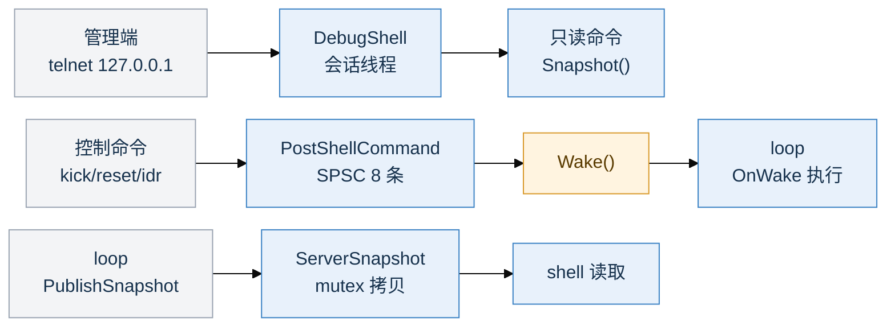

# 调试命令面设计（msh-like）

> 版本: 0.1
> 日期: 2026-11-26
> 状态: P0 只读、P1 受控、P2 故障注入均已实现；P2 需 `RS_ENABLE_FAULT_INJECTION=ON`
> 关联: `docs/2026-11-26-当前实现评审与改进建议.md`、`基于 newosp 的 RTSP Server 详细设计方案.md` §10.3
> 结论: 当前只有 5 s 周期 `stats` 打印，没有交互式调试命令；建议补一个**最小、只读优先、默认关闭**的 msh-like 命令面，再逐步加受控命令和故障注入

## 0. 结论先行

1. **确实不够**：现在只能看 `main.cpp` 每 5 s 打印的一行全局统计，无法按客户端、帧池、FD、timer、RTCP、流状态下钻，也无法在运行中踢掉慢客户端、重置计数、打开单客户端 trace 或注入故障。
2. **不需要复刻完整 msh**：RT-Thread msh 的命令数量不是目标；目标是“现场可观测、可定位、可受控恢复”。先做只读命令，再做少量受控命令，最后做测试专用故障注入。
3. **线程模型必须守住**：`DebugShell` 的命令回调运行在 shell 会话线程，不能直接改 loop 线程的 socket/session/RTP 状态。只读命令走快照；有副作用命令走有界命令队列 + `Wake()`，由 loop 执行。
4. **默认关闭**：生产镜像默认不启动 shell；需要时绑定 `127.0.0.1` 或 Unix socket，并启用 admin 凭据。测试镜像可打开故障注入。

| 优先级 | 内容 | 目的 |
|---|---|---|
| P0 | `help/version/stats/clients/client/pool/fd/timers/stream/rtcp/latency/mem` | 只读可观测，零状态修改 |
| P1 | `log/kick/reset/idr/shutdown/trace` | 受控运维与定位 |
| P2 | `fault drop/stall/eagain/idr`、`simulate slow` | 测试专用，编译期开关 |

### 0.1 实现状态（2026-11-26 01:15）

| 项 | 状态 | 落点 |
|---|---|---|
| 快照结构 | 已完成 | `ServerSnapshot`/`ClientSnapshot`（`rtsp_server.hpp`）、`SessionSnapshot`（`rtsp_session.hpp`）、`FrameIngressStats`（`frame_ingress.hpp`） |
| 快照发布 | 已完成 | `RtspServer::PublishSnapshot()` 每 100 ms 维护周期发布；`Snapshot()` 加锁拷贝 |
| shell 入口 | 已完成 | `include/rs/debug_shell.hpp`、`src/debug_shell.cpp`、`main.cpp --shell-port/--shell-bind` |
| 构建开关 | 已完成 | CMake `RS_ENABLE_DEBUG_SHELL`，默认 OFF；仅 `rtspserver_demo` 链接 shell |
| P0 命令 | 已完成 | `stats/clients/client/pool/fd/timers/stream/rtcp/latency/mem/config/time/version`（`help`/`?`/`history` 由 newosp 内置） |
| P1 受控命令 | 已完成 | `log/kick/reset/idr/shutdown/trace`；`ShellCommand` SPSC + `PostShellCommand` + `Wake()`，loop `DrainShellCommands` 执行 |
| P2 故障注入 | 已完成 | `fault drop/stall/eagain/idr`、`simulate slow`；`RS_ENABLE_FAULT_INJECTION=ON` 时注册 |

验证记录：

- `cmake -S . -B build_review -DRS_ENABLE_DEBUG_SHELL=ON ...` 构建通过。
- `ctest --test-dir build_review` 10/10 通过。
- `rtspserver_demo --shell-port 15090` 手动 telnet 验证：`help/version/stats/clients/client/pool/fd/timers/stream/rtcp/latency/mem/config/time` 均有输出；有 TCP PLAY 客户端时 `clients/client 0/fd` 能显示 slot、state、fd、peer、queue、seq/ts、counters。
- P1 手动验证：`log debug` 后 `trace 0 on` 产生限频 `[trace]` 行；`reset client 0` 清零该客户端 counters；`reset stats` 清零全局计数；`kick 0` 后 `clients` 为空；`shutdown` 触发优雅停机并以 0 退出。
- P2 手动验证：`fault drop 5` 后 `stats` 的 `gaps/au_drop` 增长、客户端进入 IDR 恢复；`fault stall 0 800` 暂停媒体并在到期后恢复；`fault idr 0 3` 使 PLAY 在 2 s 后以 `idr timeout` 关闭；`fault eagain 0 2` 使 UDP `udp_drops` 增长并等待 IDR；`simulate slow 0 200000` 生效，`0` 恢复。
- `RS_ENABLE_DEBUG_SHELL=OFF` 的独立构建通过，`rtspserver_demo` 不包含 shell 参数。

## 1. 现状与缺口

| 能力 | 当前实现 | 缺口 |
|---|---|---|
| 全局统计 | `ServerStats` + `main.cpp` 5 s 打印 | 无按需查询、无历史、无重置 |
| 每客户端状态 | `RtspSession` 内部有 state/counters | shell 线程不可安全直接读 |
| 帧池 | `FrameIngress` 有 slot/refs/queues | 无 `pool` 视图 |
| FD/watcher/timer | `EventLoop`/`IoPoller` 有内部表 | 无 `fd`/`timers` 视图 |
| 流状态 | `SourceMain`/`params_` | 无 codec/PTS/AU/IDR 状态查询 |
| RTCP | `rtcp.cpp` 有 SR/RR 库函数 | 无 `rtcp` 统计/触发 |
| 控制 | 无 | 不能 kick/reset/idr/trace |
| 故障注入 | 无 | 难复现慢客户端、丢帧、短写、IDR 超时 |

当前 `main.cpp` 的 `PrintStats()` 只覆盖 `conns/playing/accepts/au/idr/qdrop/tx/short/eagain/loop_us`，无法看到“第 3 个客户端为什么卡住”“帧池哪个槽被谁引用”“UDP 端口对是否连续”。

## 2. 总体架构



### 2.1 线程与所有权

| 对象 | 所有者 | shell 线程访问方式 |
|---|---|---|
| listener/TCP/UDP/session/RTP 状态 | loop | 不直接访问 |
| `ServerStats` / `ClientSnapshot` | loop 写，shell 读拷贝 | `Snapshot()` 加锁拷贝 |
| 命令队列 | shell 生产，loop 消费 | `PostShellCommand()` + `Wake()` |
| 日志级别/trace 掩码 | 原子变量 | shell 写，loop 读 |
| 故障注入配置 | 原子变量/命令 | shell 写，loop 在安全点读取 |

### 2.2 只读路径

loop 每 100 ms（或 1 s）调用 `PublishSnapshot()`，把全局统计和每客户端状态写入 `snapshot_`，由 `snapshot_mutex_` 保护。shell 的 `stats/clients/client/pool/fd/stream` 只读这个快照，不触碰 loop 状态。

快照结构建议：

```cpp
struct ClientSnapshot {
  uint32_t slot;
  uint32_t gen;
  uint8_t state;          // sess::State
  uint8_t transport;      // none/udp/tcp
  uint32_t peer_ipv4;
  uint16_t peer_port;
  uint32_t queue_depth;
  uint32_t queue_bytes;
  uint32_t oldest_age_ms;
  uint32_t seq;
  uint32_t rtp_ts;
  uint32_t ssrc;
  uint32_t queue_drops;
  uint32_t udp_drops;
  uint32_t token_waits;   // Shaping pause; the AU is kept, not dropped.
  uint32_t frames_completed;
  uint32_t packets_sent;
  uint8_t close_reason;
};

struct ServerSnapshot {
  ServerStats stats;
  ClientSnapshot clients[kMaxConnections];
  uint32_t client_count;
  uint32_t pool_free;
  uint32_t pool_in_use;
  uint32_t input_queued;
  uint32_t watchers_used;
  uint32_t timers_used;
};
```

### 2.3 控制路径

```cpp
enum class ShellCommandId : uint8_t {
  kKick = 0,
  kResetStats,
  kRequestIdr,
  kSetLogLevel,
  kSetTrace,
  kShutdown
};

struct ShellCommand {
  ShellCommandId id;
  uint32_t arg0;
  uint32_t arg1;
};

// shell 线程调用；队列满返回 false，命令不生效。
[[nodiscard]] bool RtspServer::PostShellCommand(const ShellCommand& cmd) noexcept;
```

- 队列用 `osp::SpscRingbuffer<ShellCommand, 8>`；第一版 `DebugShell` 只开 1 个会话，保证 SPSC。
- `PostShellCommand()` push 成功后调用 `Wake()`；loop 在 `OnWake()`/`OnTimer()` 的固定安全点 `DrainShellCommands()`。
- 命令执行失败/队列满通过 `stats_.shell_*` 计数，shell 返回 `busy`，不阻塞等待。
- 若以后要多会话，改用 mutex 保护的 MPSC 小队列（冷路径），不要把多生产者塞进 SPSC。

### 2.4 与 newosp `DebugShell` 的集成

- `osp::DebugShell` 是 telnet TCP，`Config` 支持 `port/max_connections/prompt/banner/username/password/admin_username/admin_password/bind_ip`。
- 命令用 `OSP_SHELL_CMD(name, desc)` / `OSP_SHELL_CMD_ADMIN(name, desc)` 静态注册；回调签名 `int(int argc, char* argv[])`，输出用 `osp::DebugShell::Printf()`。
- 回调没有 context 参数；单实例服务用 `static RtspServer* g_server`，在 `main` 中设置。多实例需求出现时再改成显式 registry。
- `DebugShell::Start()` 在冷路径为会话数组分配一次内存（`new (std::nothrow)`）；不进入媒体热路径。
- 备选：`ConsoleShell`（stdin）适合前台开发；`UartShell` 适合串口；生产建议 telnet 绑 `127.0.0.1` 或后续加 Unix socket 后端。

## 3. 命令集

### 3.1 P0：只读命令

| 命令 | 参数 | 输出 | 数据来源 |
|---|---|---|---|
| `help [cmd]` / `?` | 可选命令名 | 命令列表/用法 | newosp 内置 |
| `history` | - | 历史命令 | newosp 内置 |
| `version` | - | 服务/newosp/构建信息 | 编译期常量 |
| `stats` | - | 全局统计一行/多行 | `ServerStats` |
| `clients` | - | 每客户端：slot/state/transport/peer/queue/age/drops | `ClientSnapshot` |
| `client <slot>` | slot | 单客户端详情：seq/ts/ssrc/queue/counters | `ClientSnapshot` |
| `pool` | - | 帧槽 free/in-use、空槽队列、输入队列、orphan | `ServerSnapshot` |
| `fd` | - | listener/conn/udp/wake/poller 的 fd 与 watcher | `ServerSnapshot` |
| `timers` | - | 已注册 timer、周期、下次到期 | `ServerSnapshot` |
| `stream` | - | codec、SPS/PPS 长度、AU 速率、last PTS、IDR 间隔 | `ServerSnapshot` |
| `rtcp` | - | SR/RR 计数、最近 RR 丢包/抖动 | `ServerSnapshot` |
| `latency` | - | loop P50/P95/P99、样本数 | `ServerStats` |
| `mem` | - | 静态/用户态/Kernel socket 预算与实测 | 编译期 + `sizeof` |
| `config` | - | 端口、advertise IP、max_clients、shaping 参数 | `ServerConfig` |
| `time` | - | monotonic/wall、NTP 偏移状态 | `ServerSnapshot` |

### 3.2 P1：受控命令（admin）

| 命令 | 参数 | 动作 | 约束 |
|---|---|---|---|
| `log <level>` | error/warn/info/debug | 设置原子日志级别 | 限频，不逐包 |
| `kick <slot>` | slot | 关闭该连接，原因 `kCloseAdminKick` | 仅 loop 执行 |
| `reset [stats\|client <slot>]` | - | 重置计数（不重置配置/资源） | 仅 loop 执行 |
| `idr` | - | 请求编码器 IDR | 通过 `SetIdrRequester()` 注册回调；未注册时返回错误，文件源不注册 |
| `trace <slot> on\|off` | slot | 单客户端限频包级 trace | 仅 debug 构建；输出走日志 |
| `shutdown` | - | 请求优雅停机 | admin；设置 stop 标志，主线程调用 `Stop()` |

### 3.3 P2：测试专用故障注入（编译期开关）

| 命令 | 参数 | 动作 |
|---|---|---|
| `fault drop <n>` | n | 丢弃接下来 n 个 AU，验证 `input_seq` gap/IDR 恢复 |
| `fault stall <slot> <ms>` | slot/ms | 暂停指定连接媒体/刷新，验证慢客户端隔离 |
| `fault eagain <slot> <n>` | slot/n | 让指定 UDP 客户端发送返回 EAGAIN n 次 |
| `fault idr <slot> <n>` | slot/n | 丢弃接下来 n 个 IDR，验证 PLAY IDR 超时 |
| `simulate slow <slot> <bps>` | slot/bps | 限制单客户端读取速率 |

这些命令只在 `RS_ENABLE_FAULT_INJECTION=ON` 时注册；生产构建不包含命令字符串和注入点。

## 4. 与 RT-Thread msh 的对应

| msh 命令 | RTSP 命令 | 说明 |
|---|---|---|
| `help` / `?` | `help` / `?` | newosp 内置 |
| `version` | `version` | 构建/newosp 版本 |
| `ps` / `list_thread` | `clients` | 每客户端状态，不是线程 |
| `free` | `mem` | 用户态/内核预算 |
| `list_fd` | `fd` | listener/conn/UDP/watcher |
| `list_timer` | `timers` | 周期/one-shot |
| `date` | `time` | monotonic/wall/NTP |
| `reboot` | `shutdown` | 优雅停机，不是硬重启 |
| `MSH_CMD_EXPORT` | `OSP_SHELL_CMD` | 静态注册；本项目用 const 表/宏，不依赖 linker section |
| `FINSH_FUNCTION_EXPORT` | - | 不需要导出任意符号 |

差异：msh 命令在 shell 线程直接跑；本方案要求有副作用命令回到 loop 执行，避免跨线程改 socket/session。

## 5. 安全与部署

- **默认关闭**：`RS_ENABLE_DEBUG_SHELL=OFF`；生产镜像不监听 shell 端口。
- **绑定地址**：`bind_ip=127.0.0.1`，不要 `0.0.0.0`；后续可加 Unix socket 后端。
- **认证**：`DebugShell::Config` 支持 `username/password` 与 `admin_username/admin_password`；`kick/reset/idr/shutdown/trace` 用 `OSP_SHELL_CMD_ADMIN`。
- **命令面最小化**：只注册需要的命令；不提供任意内存读写、任意 fd 操作、任意文件读写。
- **输出限频**：`trace`/`clients` 大输出限制频率和行数；shell 输出不得进入媒体热路径。
- **日志脱敏**：不打印完整 SDP、session ID 全文、认证头或可重放凭据。
- **测试开关**：故障注入只存在于测试构建；发布前检查命令表和字符串。

## 6. 实施顺序与退出判据

| 阶段 | 内容 | 退出判据 |
|---|---|---|
| 1 只读快照 | 已完成：`ServerSnapshot`/`ClientSnapshot`、`Snapshot()`、P0 命令、`DebugShell` 默认关闭 | 已满足：shell 可查 stats/clients/pool/fd/stream；手动 smoke 通过 |
| 2 控制队列 | 已完成：`ShellCommand` SPSC、`PostShellCommand`、`DrainShellCommands`、P1 命令 | 已满足：kick/reset/log/shutdown 生效；队列满返回 busy；无跨线程状态访问 |
| 3 故障注入 | 已完成：`fault *`/`simulate slow`，`RS_ENABLE_FAULT_INJECTION` | 已满足：能复现慢客户端、丢帧、EAGAIN、IDR 超时 |
| 4 平台化 | 待实现：可选 Unix socket 后端、admin 认证、发布构建裁剪 | 生产镜像无 shell 端口/命令字符串；ARM 上内存/延迟达标 |

### 6.1 测试

- shell 解析：空行、超长行、未知命令、参数缺失、非法 slot、admin 权限。
- 快照一致性：loop 高频更新时 shell 读到的是完整快照，不是半更新结构。
- 命令队列：满队列、并发 1 个 shell 会话、`Wake()` 后 loop 执行。
- 无阻塞：shell 连续查询 1 min，loop P99 不超过基线 + 1 ms（测试阈值待定）。
- 安全：非 admin 执行 admin 命令被拒绝；`bind_ip` 非本地时启动失败或显式警告。
- 发布裁剪：`RS_ENABLE_DEBUG_SHELL=OFF` 时无 shell 符号/端口/命令字符串。

## 7. 待确认

| 编号 | 问题 | 默认假设 |
|---|---|---|
| Q-01 | shell 传输用 telnet localhost、Unix socket 还是串口？ | 首版 telnet `127.0.0.1:5090`，后续加 Unix socket |
| Q-02 | 是否允许多个 shell 会话？ | 首版 1 个，保证 SPSC；多会话再改 MPSC |
| Q-03 | 生产镜像是否保留只读命令？ | 默认全部关闭；需要时用只读构建 |
| Q-04 | `idr` 的编码器接口何时可用？ | 已提供 `SetIdrRequester()`；编码器侧需实现强制 IDR，文件源继续等待自然关键帧 |
| Q-05 | 故障注入是否进入 CI？ | 单独测试构建，不进生产镜像 |

## 8. 一句话总结

**先做“看得见”（只读快照 + P0 命令），再做“管得住”（受控命令队列），最后做“复现得了”（故障注入）；不要一上来复刻完整 msh，也不要在 shell 线程直接改 loop 状态。**
