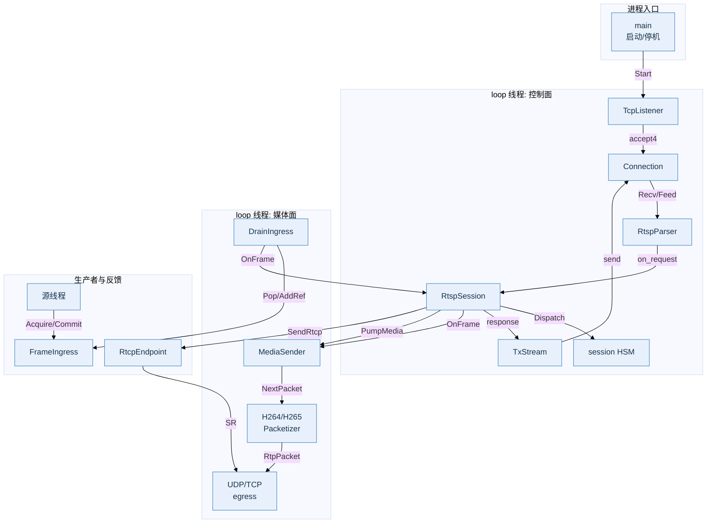
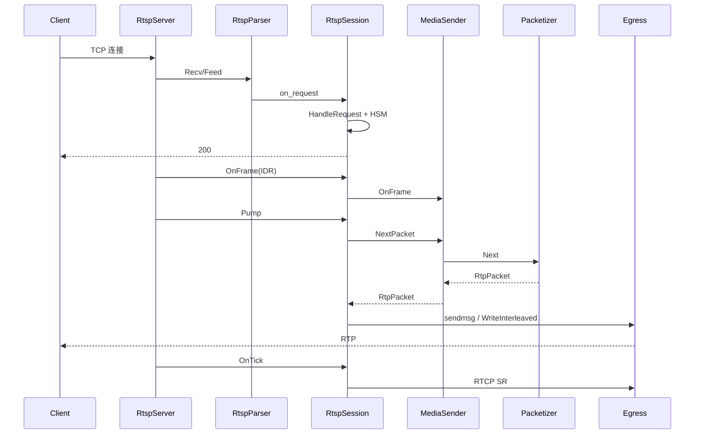
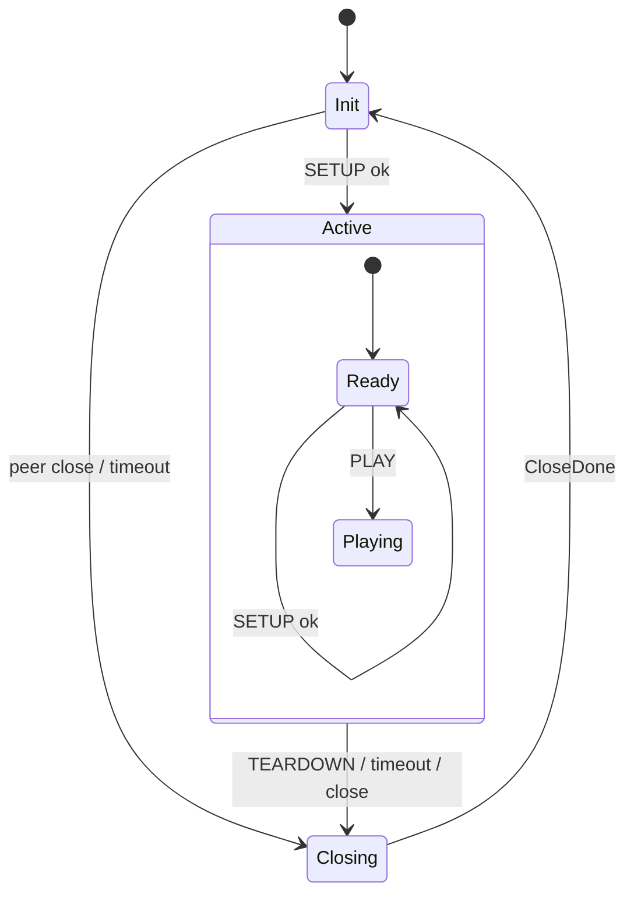

# osp-rtspserver 概要架构设计

> 范围: 只描述当前实现，不写需求与验收

## 1. 目标与边界

- 单进程 RTSP 1.0 拉流服务器，单视频轨，H.264 或 H.265 二选一。
- 输入是编码器给出的完整 Annex B access unit（AU）。服务器不编码、不解码、不转码，也不解析文件容器。
- 支持 RTP/RTCP over UDP 单播，以及 RTSP over TCP 的 interleaved 媒体与 RTCP。
- 固定容量、固定内存，媒体路径不做堆分配、不阻塞、不加跨线程锁。
- newosp 提供 `EventLoop`、`IoPoller`、`SpscRingbuffer`、`Socket`、`expected`、`log`、`DebugShell`。
- 目标平台是 Linux x86-64 与 ARM Linux；Windows 未验证，移植预计可行。
- 仅 IPv4。音频、TLS、鉴权、组播、RTSP 推流、录像回放、PAUSE、seek 不支持。

## 2. 结构

| 模块 | 文件 | 职责 |
|---|---|---|
| 入口 | `src/main.cpp` | 参数、信号、构造源与服务器、停机 |
| 服务器 | `src/rtsp_server.cpp` | 监听、连接槽、事件分派、媒体扇出、维护、快照 |
| 会话 | `src/rtsp_session.cpp` | 方法分派、状态机、SETUP/PLAY、发送流、超时 |
| 解析 | `src/rtsp_parser.cpp` | 增量请求与 `$` interleaved 帧解析 |
| SDP | `src/sdp.cpp` | H.264/H.265 SDP 与 `sprop-*` |
| 帧入口 | `src/frame_ingress.cpp` | 固定槽池、引用计数、SPSC、输入序号 |
| 媒体 | `src/media_sender.cpp` | AU 队列、游标、令牌桶、IDR 闸门 |
| 包化 | `src/h264_packetizer.cpp`、`src/h265_packetizer.cpp` | Annex B 扫描、单 NAL/FU、零拷贝视图 |
| 传输/RTCP | `src/rtp_transport.cpp`、`src/rtcp.cpp` | UDP socket 对、interleaved 写、SR/RR/BYE |
| 状态/限流/缓冲 | `src/session_hsm.cpp`、`include/rs/ip_rate_limiter.hpp`、`include/rs/tx_stream.hpp` | 生命周期表、按 IP 限流、每连接发送流 |
| 调试/源 | `src/debug_shell.cpp`、`src/file_source.cpp` | 只读快照命令；测试用 Annex B 文件源 |

运行期调用顺序：

线程数量：默认 3 个。开启调试 shell 后为 5 个（1 个 accept + 1 个 session）；session 数由 shell 的 `max_connections` 决定，demo 设为 1。压测统计到的 3 个线程即默认未开 shell 的配置。`rs_core` 自己只创建 loop 线程；主线程由进程提供，源线程由 `FileSource` 或集成方创建。

| # | 线程 | 创建者 | 职责 | 交互 |
|---|---|---|---|---|
| 1 | 主线程 | 进程 | 参数、构造、信号、停机、最终统计 | 调 `Start()`/`Stop()`，读快照 |
| 2 | loop | `RtspServer` | 独占 listener、TCP/UDP socket、parser、session、timer | 由 `Wake()` 唤醒；读源侧原子状态 |
| 3 | 源 | `FileSource` 或集成方 | 读/生成 AU，`Acquire`/`Commit`，`Wake()` | 不碰 socket/session |
| 4 | shell accept | `DebugShell`（可选） | 监听并接受 telnet 连接 | 不碰 loop 状态 |
| 5 | shell session | `DebugShell`（可选） | 执行只读命令；管理命令投递到 SPSC | 读快照；写 `ShellCommand` 后 `Wake()` |

1. socket 的创建、读写、注册、关闭只在 loop 线程；`Stop()` 先停 loop 并 join，再关 listener。
2. 源线程只写帧槽、输入序号和两个 32 位原子计数。
3. loop 回调不等待 IDR、令牌、发送或锁，也不做堆分配。
4. 每客户端媒体状态只在 loop 线程修改；热路径不用虚函数和 `std::function`。

## 3. 控制面

接入：

- `TcpListener` 绑定 `0.0.0.0:<port>`，`SO_REUSEADDR`、非阻塞、`FD_CLOEXEC`；优先 `accept4`，基线不支持时回退 `accept + fcntl`。
- 最多 16 个连接槽，accept 后立即分配；超过 `max_clients` 或槽满时关闭。
- 每 IP 令牌桶：accept 8/s、突发 32；请求 128/s、突发 256。超限直接关闭。
- 连接 tag 为 `slot | (gen << 8)`，事件回调先校验 tag，避免 fd 复用投错连接。
- TCP 选项：发送缓冲 64 KiB、接收缓冲 32 KiB、`TCP_NOTSENT_LOWAT=16 KiB`、`TCP_USER_TIMEOUT=10 s`、keepalive 30/10/3、`TCP_NODELAY`。
- 关闭延迟到本轮事件分派结束，在 `OnWake`、维护 tick 或下一次 accept 前统一 `Flush()`。

解析：

- 每连接一个 `RtspParser`，8 KiB 线性缓冲；`Recv` 最多连续 4 轮，`EAGAIN` 返回。
- 文本请求与 `$` interleaved 帧共用解析器；只有收到 `4 + length` 字节才消费，未收全的尾帧保留。
- 限制：URI 256 B、请求头 2 KiB、头数量 24、请求体 4 KiB、interleaved 负载不超过 8188 B。

OPTIONS 返回 `Public`；DESCRIBE 校验 `Accept` 与参数集后返回 SDP；SETUP 建立 UDP 端口对或记录通道；PLAY 要求 `Session` 与 Ready，只接受 `npt=0`；TEARDOWN 关闭媒体传输但保留连接；GET_PARAMETER 返回空体用于保活。PAUSE 与其他方法返回 405 和 `Allow`。错误码：错误 Session 454、非法状态 455、非法 Range 457、聚合 SETUP 459、非法 Transport 461、资源不足 503。

SETUP 先建资源再进 HSM；失败回滚 socket 与端口。PLAY 置 `NeedIdr`，首个 IDR 到达后写 `RTP-Info` 并开始发送；4 s 内没有 IDR 则关闭连接。

会话标识：

- 启动时用 `getrandom()` 生成 `id_seed`，失败回退 `/dev/urandom`。
- SETUP 生成 16 个十六进制字符的 session id、32 位 SSRC 和 16 位初始 seq，均由 seed、epoch 和当前时间经 SplitMix64 派生。
- SDP 固定一路视频：`m=video 0 RTP/AVP 96`、`a=control:trackID=0`；H.264 带 `packetization-mode=1`、`profile-level-id`、`sprop-parameter-sets`；H.265 带 `sprop-vps/sps/pps`。
- 聚合 URI 为 `/live`，轨道为 `/live/trackID=0`；其余路径返回 404。

发送流：

- 每连接一个 `TxStream`（32 KiB），控制响应与 TCP interleaved 媒体串行写入。
- 控制响应保留 8 KiB，媒体最多使用 24 KiB；媒体提交前检查高水位并 `Reserve()`。
- 短写只推进已发送字节；未冲刷字节 2 s 无进展则关闭连接。

## 4. 媒体面

帧入口：

- `FrameIngress` 固定 8 个槽，每槽 256 KiB，构造时分配。
- 槽有 generation 与 `uint16_t` 引用计数；loop 持 1 个引用，每个 PLAY 客户端 `AddRef` 1 个，最后一个 `Release` 归还空槽队列。
- 每次 `Acquire()` 尝试（含失败）都消耗一个 64 位 `input_seq`；loop 发现缺口即通知所有播放会话进入 AwaitIDR。
- 只有一个生产者和一个 loop 消费者；`Abort()` 保留生产者本地槽，源线程退出后才归还。

扇出：

- loop 每轮取 AU，校验后对每个 Playing 会话调用 `OnFrame`。
- AwaitIDR 时丢弃非 IDR；首个 IDR 强制带参数集，由服务端已保存的 SPS/PPS/VPS 注入。
- 队列满、输入缺口、UDP 发送失败、包化失败都会回到 AwaitIDR，并按 1 s 限频请求编码器生成 IDR。

每客户端状态：

- `MediaSender` 持有 4 个 AU 的队列和当前 AU；游标为 `std::variant<ClientCursor, HevcCursor>`，variant 分支即编码类型。
- RTP 时间戳由 `pts_ns` 映射到 90 kHz，每会话在首个 AU 建立随机基准，允许 32 位回绕。
- 令牌桶默认 8 Mbit/s、突发 32 KiB；令牌不足时保存游标并暂停，不丢 AU。
- 每轮发送预算 32 KiB 或 32 个包；游标可从 NAL/分片中间继续。

包化：

| 编码 | 单 NAL | 分片 | 参数集 |
|---|---|---|---|
| H.264 | RFC 6184 单 NAL | FU-A，2 字节 FU 头 | SPS、PPS |
| H.265 | RFC 7798 单 NAL | FU，3 字节（2 字节载荷头 + 1 字节 FU 头） | VPS、SPS、PPS |

- 起始码支持 3/4 字节；4 字节起始码的前导零按上一 NAL 的尾部零裁掉，RTP 负载不含起始码。
- `RtpPacket` 是只读视图：RTP 头和 FU 头在每客户端游标，负载指向共享 AU 或参数集。
- UDP 用 `sendmsg` 三个 iovec 发送，不做逐包复制；负载上限 1200 B。
- 同一 AU 的所有包共享时间戳，最后一个包置 marker。

出口：

- UDP 每会话一对 connected socket：RTP 偶数临时端口，RTCP 绑定 `RTP+1`；失败换端口重试，成功后回写 `server_port`。
- RTCP fd 注册到同一 poller，事件按 slot + generation 校验。
- TCP 写成 `$ | channel | 16-bit length | RTP`，RTCP 写在协商的 `rtcp_channel`（默认 RTP+1）。
- UDP `EAGAIN/ENOBUFS` 丢当前包并等待 IDR；TCP 短写保留剩余字节，2 s 无进展关闭。

时间：

- RTCP SR 的 NTP 字段取 `CLOCK_REALTIME`，RTP 字段由最近发送的 RTP 时间戳加单调时间外推。
- 首个 SR 在首包后 1 s 发出，之后 5 s ±50%。
- 入站 RTCP 按 compound 解析：首个包必须是 SR/RR；统计 RR、BYE、坏包；BYE 关闭会话。

## 5. 状态机

- `Active` 是 `Ready` 与 `Playing` 的父状态，TEARDOWN、超时、peer close 在父状态统一处理。
- 服务生命周期另有一套 HSM：`Init → Ready → Running → Stopping → Stopped`；`Stop()` 先拒绝新帧，再停 loop、join、关 listener、关连接；源线程由调用方先停。
- `Stop()` 后同一 `RtspServer` 不能再次 `Start()`，集成方需重建对象。

## 6. 内存与容量

| 项 | 值 |
|---|---:|
| 连接槽 | 16 |
| 帧槽 | 8 × 256 KiB |
| 输入队列 / 空槽队列 | 8 / 16 |
| 每会话 AU 队列 | 4 |
| 每连接 RX / TX | 8 KiB / 32 KiB |
| RTP 负载 | 1200 B |
| 参数集 | 256 B/个 |
| 单会话单轮预算 | 32 KiB / 32 包 |
| Poller fd / Timer | 64 / 8 |

- `FrameIngress`、`RtspParser`、`TxStream`、`FileSource` 按 64 B cache line 对齐；`FrameDesc` 不超过 32 B。
- `rs_core` 不引用 `operator new`，CI 在 aarch64 目标文件上做零堆符号审计；可选的 DebugShell 与 newosp 内部实现不在该断言内。
- 编译期关闭异常与 RTTI，负向编译测试保证该约束不被破坏。
- `sizeof(RtspServer)` 约 2.8 MiB，其中帧池 2 MiB；`sizeof(RtspSession)` 约 34 KiB，`sizeof(RtspParser)` 约 8 KiB。未计线程栈、内核缓冲与编码器内存。

## 7. 背压与故障

| 条件 | 动作 |
|---|---|
| 控制响应放不下 | 关闭连接 |
| TCP 未冲刷字节 2 s 无进展 | 关闭连接 |
| TCP 短写 | 保留剩余字节，等待 writable |
| 令牌不足 | 暂停游标，保留 AU |
| 每会话队列满 | 丢 AU，进入 AwaitIDR，请求 IDR |
| 源序号缺口 | 所有播放会话进入 AwaitIDR |
| UDP `EAGAIN/ENOBUFS` | 丢当前包，进入 AwaitIDR |
| PLAY 后 4 s 无 IDR | 关闭连接 |
| 60 s 无客户端请求或有效 RTCP | 关闭会话 |
| SETUP 前 10 s 无进展 | 关闭连接 |
| accept 遇到 `EMFILE/ENFILE` | 摘除 listener，100 ms 后重挂 |
| 参数集变更 | 关闭旧连接，要求重新 DESCRIBE/SETUP |
| RTCP BYE | 关闭会话 |

- 源静默停流尚未接入独立的会话关闭路径；客户端保活会让会话保持 Playing。
- 控制响应不能抢占已排队的 TCP 媒体；慢客户端靠高水位和停滞超时隔离。
- UDP 丢包只有发送失败可见；网络中途丢包不会触发 IDR。

## 8. 异常与边界

| 层 | 已处理 | 主要缺口 |
|---|---|---|
| 启动 | 配置/参数/监听失败返回错误；失败路径关 listener | `StartThreads` 失败后 timer、HSM、ingress 未复位，二次 `Start` 失败 |
| 接入 | `EMFILE` 退避、槽满/限流关闭、tag 校验、延迟关闭 | `SetNonBlocking`/`SetNoDelay` 失败被忽略 |
| 解析 | 溢出、畸形、超长、超头、超大 body、坏 interleaved 均关闭 | 无请求完成 deadline；不拒绝 `Transfer-Encoding` |
| 会话 | 400/404/405/454/455/457/459/461/503；PLAY 等 IDR 超时 | 重复 SETUP 打开失败时把 `transport_` 置 None，旧传输不再工作 |
| 媒体 | 队列满、输入缺口、UDP `EAGAIN`、包化失败、令牌暂停 | `AddRef` 失败（`kNoRef`）未计数也未进入 AwaitIDR |
| RTCP | 坏包计数、BYE 关闭、SR 发送失败 1 s 重试 | 接收缓冲 128 B，大 compound 被截断 |
| 停机 | 幂等；先停 loop、join、关连接 | 源静默停流不关会话；同一对象不能重启 |
| 安全 | session id/SSRC 用 `getrandom` | `getrandom` 失败回退单调时钟，ID 可预测 |

按风险排序：重复 SETUP 失败 > `Start` 回滚 > `kNoRef` > RTCP/CSeq/`SetNonBlocking` 防御项。

## 9. 部署与集成

- 每个 `FrameIngress` 只允许一个生产者；每次提交一个完整 AU，分别处理 `Acquire`/`Commit` 失败。
- `pts_ns` 使用同一时间基准且不得回退；B 帧导致的输出顺序回退需先适配。
- 正确设置 IDR/IRAP 标志；参数集长度和 AU 大小不得超过编译期上限。
- `SetIdrRequester()` 回调运行在 loop 线程，只能做有界非阻塞操作；请求不代表硬件已生成 IDR。
- `UpdateTrackParams()` 成功仅表示提交；loop 应用后关闭旧连接，客户端需重新 DESCRIBE/SETUP。
- 停机时先停止并 join 生产者，再调用 `Stop()`。

loop 与源线程使用默认 pthread 属性；先测普通调度下的取帧超时、loop 延迟和发送退化，再决定是否使用实时优先级。

| 场景 | 验证项 | 状态 |
|---|---|---|
| x86 功能回归 | 两种编码、TCP/UDP、参数集与封包、关键帧请求 | 已覆盖 |
| x86 资源与并发 | 16 路、两种编码、TCP/UDP 混合及单一传输 | H.264 混合传输已测，其他组合待测 |
| 抖动与故障 | 慢读、带宽限制、延迟、丢包、输入停流和恢复 | 双客户端黑洞场景已测，其余待测 |
| ARM 构建 | 目标 ABI、工具链、`-fno-exceptions -fno-rtti` | 待目标工具链 |
| ARM 硬件 | 真实编码器、16 路长稳、重连、参数集变化 | 待目标板 |

产品需先确定码率、分辨率、帧率、GOP、最大 IDR、网络模型、可用内存和 CPU 预算。16 路 4 Mbit/s 的媒体负载约 64 Mbit/s，不含协议开销与突发余量。帧池 2 MiB，16 路用户态收发缓冲合计 640 KiB；不含线程栈、内核缓冲与编码器内存。

## 10. 限制与取舍

| 项 | 选择与代价 |
|---|---|
| 并发 | 单 reactor + 生产者线程，避免锁序与跨线程 socket 竞争；代价是单核上限 |
| 内存 | 固定池 + 编译期上限，可预测、无碎片；代价是容量调整需重编译与回归 |
| 包化 | 共享 AU + 每客户端游标，UDP 零拷贝、TCP 复制一次；代价是 AU 生命周期依赖引用计数 |
| PLAY | 等首个 IDR 再回 200，保证 RTP-Info 与首包一致；代价是响应受 GOP 影响 |
| TCP 出口 | 单一有界 FIFO，interleaved 帧不会被响应插入；代价是控制消息不能抢占媒体 |
| URI | 固定 `/live` 与 trackID，行为可预测；代价是部分 NVR 的聚合 SETUP 需兼容开关 |
| 慢客户端 | 隔离并关闭，保护其他客户端与 loop 延迟；代价是弱网连接会被主动断开 |

- 未做 VLC/NVR 实机、600 s 长稳与 ARM 板测。
