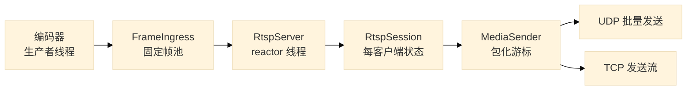

# 面向嵌入式的 RTSP Server：设计与实现对比

嵌入式设备需要将编码器输出的视频提供给外部客户端取流，同时控制连接数、内存占用和慢客户端的影响。为此，[osp-rtspserver](https://github.com/DeguiLiu/osp-rtspserver) 提供单路视频 RTSP 拉流服务，面向嵌入式 Linux 部署。

与 [PHZ76/RtspServer](https://github.com/PHZ76/RtspServer) 相比，osp-rtspserver 用较窄的功能范围换取固定容量和更明确的资源边界；PHZ76/RtspServer 则支持更多媒体类型和使用场景。

## 1. 定位与功能

| 项目 | PHZ76/RtspServer | osp-rtspserver |
|---|---|---|
| 使用场景 | 通用 RTSP 服务端与推流端 | 单路编码视频的嵌入式拉流服务 |
| 视频与音频 | H.264、H.265、AAC、G.711A、VP8 | H.264 或 H.265，单视频轨，无音频 |
| 传输与协议 | 支持单播、组播和推流；包含 Digest 鉴权实现 | UDP 单播、TCP interleaved；无组播、推流和鉴权 |
| 平台 | Linux、Windows | 支持 Linux x86-64、ARM Linux；Windows  |
| 并发容量 | 使用动态容器管理连接和任务 | 编译期固定 4～16 个连接槽，默认 16 |

[osp-rtspserver](https://github.com/DeguiLiu/osp-rtspserver)不实现需要音频、组播或推流的场景，也未提供 TLS，当前应部署在可信网络。

按仓库物理行数统计，核心实现 不到**8000 行**。

## 2. 架构与数据路径

[PHZ76/RtspServer](https://github.com/PHZ76/RtspServer) 使用事件调度器和任务队列，可配置多个调度线程；媒体路径使用动态分配的帧、RTP 包和共享指针。[osp-rtspserver](https://github.com/DeguiLiu/osp-rtspserver) 将媒体入口与网络处理分开：生产者提交帧，单个 reactor 线程负责连接、会话和 socket。

| 方面 | [PHZ76/RtspServer](https://github.com/PHZ76/RtspServer)  | [osp-rtspserver](https://github.com/DeguiLiu/osp-rtspserver)  |
|---|---|---|
| 线程归属 | 调度器执行投递任务 | 一个 reactor 管理网络事件和会话，媒体热路径不依赖跨线程会话锁 |
| 帧存储 | 帧和 RTP 包使用动态分配与共享所有权 | 8 个固定帧槽，每槽 256 KiB；客户端共享 AU，通过引用计数管理生命周期 |
| 扇出 | RTP 包经调度任务交给客户端 | 每个客户端保存独立游标和发送状态，负载视图指向共享帧 |
| UDP 发送 | 逐包发送 | 使用分散缓冲发送；Linux 下最多 8 包一次 `sendmmsg`，减少系统调用次数 |
| TCP 发送 | 数据进入动态发送队列 | 每连接固定 32 KiB `TxStream`，控制响应与媒体按顺序发送 |

这里的零拷贝仅指包化视图不复制共享帧负载，以及 UDP 发送前无需将各段拼成连续用户态缓冲。TCP 路径仍需把数据复制到发送流，内核也可能复制数据。NAL 扫描游标属于客户端状态，不能理解为所有客户端只解析一次。

示例程序默认包含主线程、文件源线程和 reactor 线程；`rs_core` 自身创建 reactor 线程。启用调试 shell 后还会增加 shell 线程，集成编码器时的生产者线程由应用决定。

## 3. 资源边界与慢客户端

[osp-rtspserver](https://github.com/DeguiLiu/osp-rtspserver) 的主要优势是资源占用有编译期上界，但固定预留不等于整个进程的内存固定，也不保证最坏执行时间。

| 方面 | 本工程 | 作用与代价 |
|---|---|---|
| 连接槽 | 默认 16，可编译为 4～16 | 按产品并发上限减少常驻内存；超出运行时或编译期上限的连接会被关闭 |
| 帧池 | 8 × 256 KiB | 多客户端共享帧，不随客户端数复制帧池；固定占用 2 MiB |
| 发送缓冲 | 每连接 32 KiB，其中媒体最多使用 24 KiB | 保留控制响应空间；慢读时仍有丢帧或断开风险 |
| 发送进度 | 未发送数据持续 2 s 无进展则关闭连接 | 防止单个 TCP 连接无限占用发送资源 |
| 媒体恢复 | 新客户端和输入缺口等待关键帧；可回调编码器请求 IDR | 避免从预测帧起播；回调需要集成方实现，恢复仍依赖编码器提供关键帧 |
| 接入保护 | 全局连接上限、按 IP 接入和请求限速 | 限制资源耗尽风险；不能替代鉴权和网络隔离 |

## 4. 健壮性设计

架构通过明确线程所有权和资源上限缩小故障影响范围，代码针对具体异常提供处理，但不能据此认定所有异常均已覆盖。

| 场景 | 处理方式 | 作用与限制 |
|---|---|---|
| 半包或非法请求 | 增量解析，限制接收缓冲、请求头和请求体；错误或超限时关闭连接 | 防止无限缓冲；尚无请求完成期限 |
| 客户端断开或描述符复用 | loop 统一处理连接，延迟关闭并校验槽位代际 | 避免旧事件误投递给新连接 |
| 写阻塞或慢客户端 | 处理短写与 `EAGAIN`，限制发送区并检测停滞 | 不阻塞其他会话；慢客户端可能丢帧或被关闭 |
| 帧丢失或队列满 | 等待关键帧，按限频策略请求 IDR | 减少错误预测帧传播；恢复依赖编码器 |
| 启动或传输资源失败 | 返回错误，启动失败回滚资源；重复 SETUP 失败时恢复旧传输 | 避免部分初始化或替换失败破坏现有传输 |
| 停机 | 停止接收新帧，停止并等待 loop，再清理连接 | 避免并发访问已释放资源；正常 `Stop()` 后需重新构造对象 |

已知缺口包括：源静默停流不会主动关闭会话；UDP RTCP 接收缓冲为 128 B，大型复合包可能被截断；请求解析尚不拒绝 `Transfer-Encoding`。这些限制影响异常网络和互通场景，不能以单元测试通过代替处理。

## 5. 协议与可观测性

| 方面 | 本工程的实现 | 实际价值与边界 |
|---|---|---|
| RTP 时间戳 | 根据输入 AU 的 PTS 映射至 90 kHz 时钟 | 队列等待不改变媒体时间轴；输入 PTS 需满足接口要求 |
| RTCP | 发送 SR/SDES，接收并处理 RR/BYE，支持 UDP 和 TCP interleaved | 可提供发送时钟和接收反馈；客户端完整互通仍需验证 |
| 会话状态 | 使用状态机管理 SETUP、PLAY 和关闭 | 非法状态有明确处理；PAUSE 不支持 |
| 连接与网络 | 非阻塞 I/O、超时、TCP keepalive、按 IP 限速 | 限制异常连接占用；检测时间受网络和系统配置影响 |
| 调试 | `status` 汇总配置、连接、帧池、RTCP、延迟和网络指标；`client <slot>` 查看单连接 | 少量命令提供集中快照；调试 shell 为可选组件 |

## 6. 测试结果

Linux x86-64 、loopback、H.264、每路 4 Mbit/s、8 路 TCP 加 8 路 UDP、运行 60 s 的结果如下：

测试环境为共享虚拟机，系统可见 100 个逻辑 CPU。当前环境识别的处理器为 Intel Xeon Gold 6348，标称频率 2.60 GHz；原压测记录未单独保存 CPU 型号。

压测使用脚本生成的码流：分辨率配置为 1280 × 720，帧率 25 fps，目标码率 4 Mbit/s。按目标码率估算，平均每帧约 19.5 KiB；实际帧大小随画面内容和帧类型变化，原压测未记录单帧最小值和最大值。帧池单槽上限为 256 KiB。

| 指标 | 本工程实测 |
|---|---:|
| 客户端存活 | 16/16 |
| CPU 平均 / 最大 | 3.85% / 6.41% |
| RSS / 线程数 | 约 3.91 MiB / 3 |
| reactor 延迟 P50 / P95 / P99 | 5 / 162 / 255 µs |
| 输入缺口 / 队列丢弃 / 发送停滞 | 0 / 0 / 0 |

CPU 占用仅统计服务端进程，100% 表示占满一个逻辑 CPU，不含客户端进程。

1080P 补充测试使用 H.264、1920 × 1080、25 fps、目标 4 Mbit/s 的生成码流，500 帧中最大帧为 65,659 B。8 路 TCP 加 8 路 UDP 运行 20 s，客户端均完成，输入丢弃、输入缺口和队列丢弃均为 0。TCP、UDP 各一路另完成 8 s 解码，两端日志均出现非单调 DTS 告警；高码率、大 IDR 和实际编码器仍需验证。
