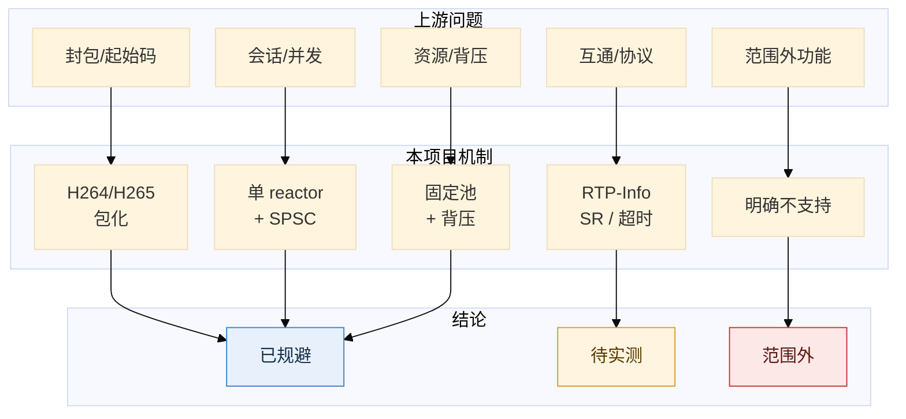

# PHZ76/RtspServer Issue 对照核查

> 对象: `https://github.com/PHZ76/RtspServer/issues`，共 85 个非 PR issue（含 open 与 closed）
> 方法: 拉取全部 issue 正文和主要评论，逐项对照本仓库源码、单元测试与已有实测报告；不把上游"closed"当作"已修复"
> 结论: 本项目有 4 项真实风险，其中 3 项已修正、1 项记录为 API 限制；其余为已规避、已实现、明确范围外或上游用法问题

## 1. 结论

- **不适用 20 项**：多为上游 Makefile/示例/平台/用法问题。本项目使用 CMake、C++17、固定 URI，且入口是已编码的 Annex B access unit，不重复上游的文件读取与示例代码。
- **已规避 28 项、已实现 7 项**：起始码剥离、FU-A/FU 分片、RTP-Info、RTCP、单线程无锁、固定帧池、连接与发送超时等，在代码和单测中有直接对应。
- **范围外 24 项**：音频、组播、TLS、鉴权、IPv6、RTSP 推流、录像回放、PAUSE 等，本项目均未实现。
- **待实测 3 项**：海康 NVR（#49）、VLC 2 s 延时（#59）、GStreamer（#84）。实现路径存在，但缺少目标客户端实测，不能用单元测试代替。
- **已修正 2 项、记录限制 1 项**：#74、#89 的代码已改；#55 记录为 API 限制。以上合计 85 项。
- **跨 issue 的真实风险 4 项**（不对应单一状态）：

| 编号 | 风险 | 处置 |
|---|---|---|
| R1 | PLAY 的 200 响应要等首个 IDR，原超时 2 s 恰好等于 A-01 假设的 GOP，没有余量 | 已改为 4 s（一个 GOP + 2 s） |
| R2 | 带内 SPS/PPS 只在 AU 自带参数集时注入；单次发送参数的编码器在新客户端起播或丢帧恢复时可能缺参 | 已改为 AwaitIDR 后的首个 IDR 强制带内注入 |
| R3 | `Transport` 强制要求 `unicast` 关键字，省略时返回 461，违反 RFC 2326 的默认值，影响 NVR 兼容 | 已改为缺省按 unicast 处理 |
| R4 | `Stop()` 之后同一 `RtspServer` 对象不能再次 `Start()` | 记录为 API 限制；进程内重启需单独设计 |

## 2. 上游问题分布



## 3. 逐项对照

| # | 上游问题 | 判定 | 本项目依据与处置 |
|---|---|---|---|
| 1 | H264 文件推流用法 | 不适用 | 本项目要求 `--file`/`--ip`，默认 8554，避开 554 权限 |
| 2 | 空 issue | 不适用 | 无内容 |
| 3 | 要求 C++11 | 不适用 | 明确要求 C++17；见 `CMakeLists.txt` |
| 6 | hi3516 退出时 pure virtual | 已规避 | 无虚接口，事件循环为 CRTP；板测待补 |
| 7 | 播放 10 s 无数据 | 已规避 | PLAY 等首个 IDR；R1 已放宽超时 |
| 8 | UDP 拼写与空 session 崩溃 | 已规避 | DESCRIBE 先校验参数集，失败返回 500，不解引用空指针 |
| 9 | 示例拼写错误 | 不适用 | 无该示例文件 |
| 11 | 媒体回调无锁 | 已规避 | 单 reactor 线程 + SPSC，媒体路径无锁 |
| 12 | 许可证 | 已实现 | MIT LICENSE |
| 13 | 无用户名密码 | 范围外 | 未实现鉴权，仅限可信网络部署 |
| 14 | 动画是否模拟 | 不适用 | 与实现无关 |
| 15 | OBS 连不上（bind 0.0.0.0） | 不适用 | 本项目固定 bind 0.0.0.0 |
| 16 | 鉴权不生效 | 范围外 | 未实现鉴权，不存在"半实现"路径 |
| 17 | RTP 时间戳超 32 位 | 已规避 | 相对 PTS + 32 位回绕；`TestRtpTimestampWrap` |
| 18 | 本机连不上 | 不适用 | 用法/防火墙；`--ip` 必须可达 |
| 19 | 示例使用 | 不适用 | 无该示例 |
| 20 | 多路推流/多 session | 范围外 | 单视频轨，固定 `/live` |
| 21 | Makefile 问题 | 不适用 | 使用 CMake |
| 23 | URL 与 token 动态化 | 范围外 | 固定 URI；非法 URI 返回 404，不崩溃 |
| 24 | 起播花屏 | 已规避 | 等 IDR；R2 保证带内参数完整 |
| 25 | readFrame 只判断 NAL 1/5 | 不适用 | AU 边界由编码器给定，仅识别 IDR/IRAP |
| 26 | H.265 未去起始码 | 已规避 | 包化器剥离 3/4 字节起始码；单测覆盖 |
| 27 | 服务端回发数据 | 已实现 | RTCP SR/RR 已回发；无应用层回传通道 |
| 28 | RTSP over SSL | 范围外 | 未实现 TLS |
| 29 | VP8/Opus | 范围外 | 无音频、无 VP8 |
| 30 | 录像 | 范围外 | 文件源仅为测试输入 |
| 31 | shared_ptr 数组泄漏 | 不适用 | 固定帧池，无逐包堆分配 |
| 32 | 发送图像帧失败 | 不适用 | 入口必须是已编码 Annex B AU |
| 33 | Android 移植 | 范围外 | 目标 Linux x86-64 / ARM Linux |
| 34 | cv::Mat 推流 | 不适用 | 需先编码为 Annex B AU |
| 36 | MediaPlayer 会话被删 | 已规避 | `EAGAIN` 不关闭；仅 EOF/错误关闭 |
| 38 | 操作流程 | 不适用 | 用法问题 |
| 39 | 读帧大小 -1 | 不适用 | 上游示例读取问题 |
| 40 | 改用 pthread_create | 已实现 | 本项目直接使用 pthread |
| 43 | 接收 RTSP 推流 | 范围外 | 拉流 Server，无 ANNOUNCE/RECORD |
| 44 | BufferWriter 满后静默丢包 | 已规避 | 有界 tx + 背压；2 s 停滞关闭连接 |
| 45 | 账号密码 | 范围外 | 同 #13 |
| 47 | UDP 丢包 | 已规避 | FU-A 分片、1200 负载、DSCP、令牌桶；突发见第 5 节 |
| 49 | 海康 NVR 预览/回放 | 待实测 | 聚合 URI 459、PLAY 延迟、SR 时序需真机 |
| 50 | 内存占用 3 MB | 已规避 | 静态 2.8 MB（帧池 2 MiB），RSS 实测 5.6 MB |
| 51 | H.265 示例 | 已实现 | 文件示例 + `encoder_source_demo` |
| 53 | VLC 时间不走 | 已规避 | RTP-Info 的 seq/rtptime 与 `Range: npt=0-` |
| 54 | 新版本不工作 | 不适用 | 上游构建问题 |
| 55 | IP 变化后重启失败 | 记录限制 | bind 0.0.0.0 免受 IP 变化；Stop→Start 不支持（R4） |
| 56 | H.265 temporal ID 非法 | 已规避 | FU 三字节头按 RFC 7798 保留 `nal[1]` |
| 57 | Android 可行性 | 范围外 | 平台不在范围 |
| 58 | 启停 fd 泄漏 | 已规避 | socket RAII；Stop 先停 loop 再关 listener |
| 59 | 2 s 延时 | 待实测 | 无额外媒体缓冲；需 VLC/ffmpeg 对照 |
| 60 | 增加 RTCP | 已实现 | SR/SDES/RR/BYE；UDP watcher + TCP interleaved |
| 61 | 出现双起始码 | 已规避 | 剥离起始码并去尾部零；单测含 4 字节码 |
| 62 | pusher 只推视频 | 范围外 | 无 pusher |
| 63 | RTSP client 示例 | 范围外 | 仅有测试客户端 `tests/e2e_client` |
| 64 | UWP | 范围外 | 平台不在范围 |
| 65 | 跨网接收 | 已规避 | `--ip` 指定 SDP 地址，监听 0.0.0.0 |
| 66 | epoll/select 混用 | 不适用 | 单一 IoPoller |
| 67 | path 解析内存错误 | 已规避 | 无 sscanf；有界 URI 解析 |
| 68 | 时间戳导致转协议失败 | 已规避 | 相对基准 + SR NTP 映射 |
| 69 | Makefile 优化 | 不适用 | 使用 CMake |
| 70 | I 帧判断 | 不适用 | 上游文件读取逻辑；AU 由编码器给定 |
| 71 | FU 使用错误地址 | 已规避 | 用剥离后的 `nal[0]` 生成 FU 头 |
| 72 | Invalid NAL unit 0 | 已规避 | 1200 负载；起始码不计入 RTP 长度 |
| 73 | H.265 server | 已实现 | RFC 7798 单 NAL + FU |
| 74 | 起始 SR | 已修正 | 首个 SR 由 5 s 提前到 1 s |
| 75 | AAC 大包被丢弃 | 范围外 | 无音频 |
| 76 | memcpy 内存泄漏 | 已规避 | AU 引用计数；无逐包拷贝 |
| 77 | 720p H.265 卡顿 | 已规避 | UDP `sendmsg` iovec 零拷贝；TCP 单次拷贝 |
| 78 | G711A 16 kHz | 范围外 | 无音频 |
| 79 | AAC payload type 不一致 | 范围外 | 无音频 |
| 80 | CLOSE_WAIT 与无法 accept | 已规避 | EOF/RDHUP 关闭、10 s idle、延迟关闭 |
| 81 | AAC/MP4 读帧 | 范围外 | 无音频/MP4 解析 |
| 84 | GStreamer Undefined packet type | 待实测 | 包化按 RFC；需 GStreamer 实机 |
| 85 | 内存异常增长 | 已规避 | 固定队列/池；120 s RSS 恒定 |
| 86 | UDP 只实现一半 | 已实现 | SETUP/响应/端口对/UDP 收发完整 |
| 87 | x264/x265 自研 | 不适用 | 不做编码 |
| 88 | 快进快退暂停 | 范围外 | PAUSE 返回 405；非零 Range 返回 457 |
| 89 | 从 GOP 开始发送 | 已修正 | 等 IDR，且首个 IDR 强制带内参数 |
| 90 | 组播不工作 | 范围外 | 组播 SETUP 返回 461；UDP 单播已实现 |
| 91 | 拔网线影响其他客户端 | 已规避 | 非阻塞、keepalive、USER_TIMEOUT、每客户端配额 |
| 92 | 锁序死锁与定时器泄漏 | 已规避 | 单线程无跨线程媒体锁；固定 timer 表 |
| 93 | pusher 走 TCP | 范围外 | 无 pusher |
| 94 | pusher codec 参数 | 范围外 | 无 pusher |
| 95 | 录像/MP4 点播 | 范围外 | 无回放 |
| 96 | IPv6 | 范围外 | 监听、SDP 与 UDP 均 IPv4 |
| 97 | RTCP interleaved 解析 | 已规避 | 按 4+len 判断完整帧并循环；部分帧保留 |
| 99 | Linux 编译失败 | 已规避 | 逐头单独编译检查通过；GCC/C++17 CI 构建通过 |

## 4. 四项风险

R1 PLAY 等待 IDR 的超时。原 `kPlayIdrTimeoutMs=2000`，与 2 s GOP 相等，没有余量。已改为 4000 ms；GOP 更长的编码器仍需调大或按配置计算，该值是编译期常量。

R2 首个 IDR 的带内参数集。原实现只在 AU 自带 SPS/PPS 时注入，单次发参的编码器会让新客户端缺参。现在 AwaitIDR 后首个 IDR 强制置 `kFrameHasParams`，只改队列副本；`TestFirstIdrInjectsStoredParams` 验证 4 个包依次为 SPS、PPS、AUD、IDR。

R3 Transport 缺省 unicast。RFC 2326 默认单播，原实现缺 `unicast` 即 461。现在只拒绝显式 `multicast`、`ttl=`、`destination=`；`TestSetupDefaultsToUnicast` 覆盖。

R4 Stop 后再次 Start。`Stop()` 把生命周期 HSM 推进到 `Stopped`，`FrameIngress` 也停在停止态，第二次 `Start()` 返回 `kBackendFailed`。当前记录为集成限制，要求重建对象；进程内重启需先等生产者退出，再重建 ingress 与 server。

## 5. 优先级较低但建议跟进

| 项 | 说明 | 建议 |
|---|---|---|
| UDP 突发 | 每客户端令牌桶突发 32 KiB，等于单轮发送预算；4 Mbit/s 下相当于一次放行约 64 ms 数据 | 弱网/Wi-Fi 目标板把突发降到 8–16 KiB，或按包间隔整形后复测 #47/#90 |
| 聚合 URI SETUP | 设计明确返回 459；部分 NVR 可能直接对 `/live` 发 SETUP | 真机不兼容时增加兼容开关，把 `/live` 映射到 trackID=0，不改变默认行为 |
| Scale/Range | 忽略 `Scale`，2 倍速请求仍按 1 倍播放；非零 Range 返回 457 | 对直播流显式拒绝 `Scale != 1.0`，避免客户端误判为已加速 |
| SR 采样精度 | SR 的 RTP 字段由最近发送时间外推，不包含编码与排队延迟 | 需要精确 A/V 同步时，在编码器时间戳入队时记录映射点 |

## 6. 验证记录

```bash
cmake --build build_root -j8
ctest --test-dir build_root --output-on-failure
# 16/16 passed, ~35 s
```

- 公共头自包含检查：对 `include/rs/*.hpp` 逐个单独编译通过，对应 #99。
- 静态容量：`sizeof(RtspServer)` 2,795,584 B，`sizeof(FrameIngress)` 2,097,920 B，`sizeof(RtspSession)` 33,920 B。与 #50 的 3 MB 量级相当，但全部为编译期固定值。

## 7. 方法与边界

- issue 清单和正文来自 GitHub API（`state=all`，排除 PR），评论只取主要讨论；上游很多 issue 没有维护者结论，closed 不等于已修复。
- 本核查是源码与单测层面的对照，不是对上游仓库的复现测试；同一现象可能有不同根因。
- 未完成：VLC/ffplay/GStreamer 长时互通、海康等 NVR 实机、600 s 以上长稳、ARM Linux 板测。对应 #49、#59、#84 只能标记"待实测"。

