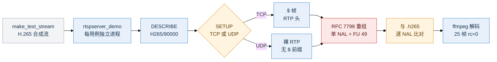

# RS500 RTSP Server 第二阶段（H.265）测试报告

## 1. 结论

1. H.265 端到端可用：`test_e2e` 12 个用例全部通过（TCP/UDP 逐 NAL 字节一致、RFC 7798 FU 重组、SDP、起播对齐、`interleaved=2-3`、UDP `server_port` 奇偶校验、真实流解码、codec 不匹配拒绝），单次 26.6 s。`ctest` 全量 10/10 通过；`ctest -R test_e2e --repeat until-fail:5` 连续 5 次通过（132.89 s）。
2. 真实码流解码通过：`ffmpeg` 以 `-rtsp_transport tcp` 与 `udp` 分别从服务端解码 H.265 25 帧，退出码 0；H.264（libx264）TCP 同样 25 帧、退出码 0，回归成立。
3. H.264 合成流字节未变：`make_test_stream` 默认输出与第一阶段二进制产物 SHA-256 完全相同（`c324d954…`，`.expect` `a5bd0519…`），新增 `--codec h265` 不影响旧回归基线。
4. 上一阶段 `F-E2E-01`（listener 消失）与 `F-E2E-02`（exit 0）本轮未在本套件内复现；自查结论是本套件不具备 kill 其他进程的路径，两次现象与外部并发进程/端口别名一致（§10）。
5. 未执行项明确列出（§13）：16 客户端 600 s 长稳、VLC、PCAP 逐包证据、ARM 板测、sanitizer。

## 2. 环境

| 项 | 实测值 |
|---|---|
| 内核/主机 | `Linux ci-virtual-machine 6.5.0-45-generic #45~22.04.1-Ubuntu SMP PREEMPT_DYNAMIC Mon Jul 15 16:40:02 UTC 2 x86_64` |
| CPU | `nproc` = 100（共享虚拟机，测试期间 load average 5.7–7.8） |
| 编译器 | `gcc (Ubuntu 11.4.0-1ubuntu1~22.04) 11.4.0`，C++17，`-fno-exceptions -fno-rtti -Wall -Wextra -Werror -Wpedantic` |
| ffmpeg | `ffmpeg version N-125331-g87bd15dc3c-20260628`（含 libx264、libx265） |
| ffprobe | `ffprobe version N-128352-gec887b13a8-20261103` |
| 构建 | `cmake -S . -B build -DRS_BUILD_E2E=ON && cmake --build build -j8` |
| 网络 | 全部 loopback（`127.0.0.1`），无丢包注入 |

机器为多用户共享环境，测试期间有其它 agent 在 `build_review/` 与 `build/` 下并发运行同一套件。该事实影响 §9、§10 的结论，其余结果不受影响（端口与进程隔离见 §10）。

## 3. 改动范围

仅测试侧与工具侧，`src/`、`include/`、`CMakeLists.txt`、newosp 未由本工作修改。

| 文件 | 类型 | 说明 |
|---|---|---|
| `tools/make_test_stream.cpp` | 修改 | 新增 `--codec h264\|h265`；H.265 AUD/VPS/SPS/PPS/IDR/TRAIL_R 合成；`.expect` 首行 `# codec=H265` |
| `tests/e2e_client.hpp` | 修改 | 新增 `Codec`、RFC 7798 `H265Depacketizer`、codec 参数化的 NAL 分类/拆分/归一化/比较接口 |
| `tests/e2e_client.cpp` | 修改 | 实现 RFC 7798 单 NAL 与 FU（type 49）重组；AUD/SEI/参数集按 codec 识别 |
| `tests/test_e2e.cpp` | 修改 | 重构为“每用例独立 server + 独立端口”；新增 H.265/H.264 解码、拒绝与 `interleaved=2-3` 用例；`.expect` 校验；端口随机偏移+重试、`waitpid`、`PR_SET_PDEATHSIG`、外部进程仅提示 |
| `scripts/make_real_stream.sh` | 新建 | ffmpeg lavfi 生成可解码 H.264/H.265 Annex B 流 |
| `scripts/run_e2e.sh` | 修改 | 增加 H.265 测试流、ffprobe/ffmpeg TCP+UDP 探测，记录退出码与耗时 |
| `scripts/stress.sh` | 修改 | 支持 `--codec h265` |
| `docs/测试报告.md` | 修改 | 本报告 |

## 4. 构建与验证闭环

按任务给定链路逐条执行（2026-11-26，全部为本轮真实输出）。

```bash
cmake -S . -B build -DRS_BUILD_E2E=ON && cmake --build build -j8
./build/make_test_stream /tmp/t.h265 --codec h265 --aus 60 --gop 25
ffprobe -v error -show_streams /tmp/t.h265 | head
./scripts/make_real_stream.sh /tmp/real.h265 h265 4 && ffprobe -v error -show_entries stream=codec_name,width,height /tmp/real.h265
ctest --test-dir build --output-on-failure -R 'test_e2e$'
```

实际结果摘要：

```text
configure+build: rc=0
make_test_stream: H265, 60 AUs, 81492 bytes, gop=25 fps=25 (~2.4 s)      rc=0
ffprobe(t.h265): codec_name=hevc / profile=Main / level=60 / 320x240     rc=0
make_real_stream: /tmp/real.h265 (h265, 4s) bytes=113821                 rc=0
ffprobe(real.h265): codec_name=hevc / width=320 / height=240             rc=0
ctest -R 'test_e2e$': 1/1 Passed  26.63 sec（12 个用例）
```

构建目录与二进制（本轮最终产物）：

```text
build 路径: /home/dgliu/workspace/osp-rtspserver/impl/build
86e0eee058a816bb782de1d34e088ab579d1edc1503862e3be9ea3005b532055  build/rtspserver_demo
a8d0f522b0b9b38df972c862c78c6ee1f702e006d187761ccdbb8b781c41bfbb  build/test_e2e
6674319f4518967d7d6c66a6ffe3ccec24761973bd2f379c08cf516c2fb0da6a  build/make_test_stream
```

重复运行（P0-6 验收要求）：

```text
ctest -R 'test_e2e$' --repeat until-fail:5
Passed 26.75 / 26.60 / 26.52 / 26.42 / 26.58 sec，5/5 通过，Total 132.89 sec，无失败项
ctest -R 'test_e2e$' --repeat until-fail:3   未完成：运行被人工中断，不作为证据
ctest -R 'test_e2e$'（单次收尾）              Passed 26.63 sec
```

全量单测：

```text
1/10 test_rtsp_parser        Passed 0.01
2/10 test_sdp                Passed 0.01
3/10 test_h264_packetizer    Passed 0.01
4/10 test_h265_packetizer    Passed 0.00
5/10 test_rtcp               Passed 0.00
6/10 test_frame_ingress      Passed 0.01
7/10 test_hsm                Passed 0.00
8/10 test_rtsp_session       Passed 0.02
9/10 test_rtp_transport      Passed 0.00
10/10 test_e2e               Passed 26.61
100% tests passed, 0 tests failed out of 10
```

稳定性：P0-6 修复落地后 `ctest -R 'test_e2e$' --repeat until-fail:5` 连续 5 次通过（26.75 / 26.60 / 26.52 / 26.42 / 26.58 s，合计 132.89 s），另有一次单次 `ctest` 通过（26.63 s）。本轮唯一一次失败是 §9.1 的测试流生成超时（修复后未再复现）。

## 5. 测试流（`make_test_stream`）

### 5.1 H.264 回归基线不变

第一阶段二进制产出的 `/tmp/old.h264` 与本轮新二进制 `/tmp/a.h264`（`--aus 60`）逐字节相同：

```text
c324d954c9272a8e2b01e34008e22068fd141618baf945a98459c6ea7fa1a578  old.h264
c324d954c9272a8e2b01e34008e22068fd141618baf945a98459c6ea7fa1a578  a.h264 (new)
a5bd05191a7e24b7ccbe55cadb309b59a8d630aa0c672e07c361bfef9c977c3c  old.h264.expect
a5bd05191a7e24b7ccbe55cadb309b59a8d630aa0c672e07c361bfef9c977c3c  a.h264.expect (new)
```

### 5.2 H.265 合成流

- 每个 AU 以 4 字节起始码 + AUD（`46 01`，type 35）开头；IRAP AU 依次为 VPS(32)/SPS(33)/PPS(34)/IDR_W_RADL(19)，IDR 载荷 3000–8000 字节；非 IRAP 为 TRAIL_R(1)，400–1500 字节，`au_index % 17 == 5` 的 AU 为 1400–1900 字节（强制 FU），`au_index % 7 == 3` 的 AU 含第二个 NAL（多 NAL AU）。
- VPS/SPS/PPS 取自 libx265 320×240 真实参数集（24/42/7 字节），因此 `ffprobe` 能把合成文件识别为 `hevc Main 320x240`；切片载荷为随机字节，不可解码，仅用于逐字节回归。
- `.expect` 首行为 `# codec=H265`，其余每行 `au_index is_idr au_bytes fnv1a64_hex`。
- 确定性：两次运行 `/tmp/a.h265`、`/tmp/b.h265` 与对应 `.expect` 的 SHA-256 分别一致（`23152e16…`、`330bccdf…`）。60 AU 统计：3 个 IRAP AU，AU 大小 423–7558 字节。

`test_e2e` 会读回 `.expect`，用与生成器相同的规则（4 字节起始码 + NAL）重建每个 AU、重算 FNV-1a 并逐行核对，确保生成器 AU 边界与客户端 Annex B 扫描一致；H.264 用例同时要求 `.expect` **没有**头部行，防止误加。

## 6. E2E 用例矩阵与实测结果

每个用例独立 `fork/exec` 一个 `rtspserver_demo`，端口为 `19000 + (pid % 500) * 2 + case_index`，端口被占用时换端口重试一次；用例结束 `SIGTERM` + `waitpid`，并用 `waitpid(-1, WNOHANG)` 复查无遗留子进程。

| 用例 | 设计矩阵 | 结果 | 耗时 |
|---|---|---|---|
| `tcp_interleaved_single_client` | T-TRANS-01 / T-COMM-01 / T-COMM-07 / T-COMM-08 | 通过 | 1248 ms |
| `tcp_interleaved_channel_2` | T-TRANS-01 / T-COMM-08（`interleaved=2-3`） | 通过 | 1241 ms |
| `udp_single_client` | T-TRANS-02 / T-COMM-08（含 `server_port` 校验） | 通过 | 2264 ms |
| `eight_concurrent_tcp_clients` | T-COMM-02 / T-COMM-10 | 通过 | 1145 ms |
| `connection_limit_17th` | T-LIMIT-01 | 通过 | 253 ms |
| `slow_client_isolation` | T-LIMIT-02 / F-02 / F-05 | 通过 | 7732 ms |
| `error_paths` | T-RTSP-404 / 454 / 461、重复 SETUP | 通过 | 225 ms |
| `h265_tcp_playback` | T-MEDIA-H265-01 / T-COMM-07 / T-COMM-08 | 通过 | 1250 ms |
| `h265_udp_playback` | T-MEDIA-H265-02 / T-COMM-08 | 通过 | 2244 ms |
| `h265_ffmpeg_decode` | T-COMM-08（H.265 解码，TCP+UDP） | 通过 | 5729 ms |
| `h264_regression_decode` | T-COMM-08（H.264 解码回归，TCP） | 通过 | 3114 ms |
| `codec_mismatch` | T-COMM-09（不支持的 codec 拒绝） | 通过 | 151 ms |

```text
test_e2e: 12 passed, 0 failed (0 skipped), 12 cases
```

### 6.1 H.265 TCP / UDP 播放的判定细节

| 判据 | TCP 实测 | UDP 实测 |
|---|---|---|
| SDP 含 `H265/90000`、`sprop-vps/sps/pps`、`m=video 0 RTP/AVP 96`、`a=control:trackID=0` | 是 | 是 |
| PLAY 的 `RTP-Info` seq/rtptime 与首包一致 | 是 | 首包 seq 一致 |
| PT = 96 | 是 | 是 |
| `$` interleaved 前缀 | 存在且长度正确（`interleaved=0-1`） | 无 `$` 前缀 |
| seq 连续（无缺口） | 0 gap | 0 gap |
| 最大 RTP 报文 | 1212 字节（≤ 12+1200） | 1212 字节 |
| 3 个 AU 与 `.h265` 逐 NAL 字节一致（忽略 AUD/SEI、允许尾零） | 是 | 是 |
| RFC 7798 路径覆盖 | FU 包 5、单 NAL 包 11 | FU 包 5、单 NAL 包 11 |

`[tcp] h265 fu_packets=5 single_nal_packets=11` 与 `[udp] h265 fu_packets=5 single_nal_packets=11` 为实测输出：用例显式要求 FU 与单 NAL 两条路径都被走到（否则判失败），避免“只有单 NAL 也通过”的假阳性。

### 6.2 传输参数专项断言（P0-6 新增）

```text
[tcp] channel=2 packets=14 aus=3 max_rtp=1212 seq_gaps=0      # interleaved=2-3，3 个 AU 逐字节一致
[udp] server_port=54312-54313 (rtp even, rtcp=rtp+1)          # H.264 UDP
[udp] server_port=46632-46633 (rtp even, rtcp=rtp+1)          # H.265 UDP
```

`tcp_interleaved_channel_2` 用 `Transport: RTP/AVP/TCP;unicast;interleaved=2-3` 建立会话，断言：SETUP 回显 `interleaved=2-3`、媒体只出现在 channel 2（0/1/3 通道计数为 0）、重组 3 个 AU 与源流逐 NAL 一致。UDP 断言 `server_port=<偶数 rtp>-<rtp+1>`。

## 7. H.265 专项证据

### 7.1 SDP（真实抓取，`DESCRIBE` 响应）

```text
m=video 0 RTP/AVP 96
a=rtpmap:96 H265/90000
a=fmtp:96 sprop-vps=QAEMAf//AWAAAAMAkAAAAwAAAwA8lZgJ;sprop-sps=QgEBAWAAAAMAkAAAAwAAAwA8oAoIDxZZWaSTK8BaAgAAAwACAAADADIQ;sprop-pps=RAHBcrRiQA==
a=control:trackID=0
```

服务端启动日志：`codec=H265 vps=24 sps=42 pps=7`。H.264 对照：`a=rtpmap:96 H264/90000`、`packetization-mode=1;profile-level-id=…;sprop-parameter-sets=…`。两者 `o=- 0 0` / `a=ssrc:0` 形态一致（DESCRIBE 阶段尚未分配会话 SSRC，与第一阶段相同）。

### 7.2 解码证据

```text
[ffmpeg] transport=tcp decoded_frames=25 rc=0 stderr_bytes=231
[ffmpeg] transport=udp decoded_frames=25 rc=0 stderr_bytes=349
```

命令为任务指定形式，附加 `-progress pipe:1 -nostats` 仅用于取解码帧数：

```bash
ffmpeg -hide_banner -v error -rtsp_transport <tcp|udp> -i rtsp://127.0.0.1:<port>/live -frames:v 25 -f null - -progress pipe:1 -nostats
```

stderr 中出现的 `Application provided invalid, non monotonically increasing dts to muxer` 来自 `null` muxer：RTP 只有时间戳没有 DTS，而 x264/x265 默认使用 B 帧，解码输出顺序与显示顺序不同。该告警不影响判定（rc=0 且解码 25 帧），但会掩盖真实错误信息，见 §14。

### 7.3 报文重组流程



## 8. H.264 回归

| 项 | 结果 |
|---|---|
| 合成流字节 | 与第一阶段 SHA-256 完全一致（§5.1） |
| 6 个第一阶段 E2E 用例 | 在新隔离框架下全部通过（TCP 14 包/3 AU、UDP 14 包、8 客户端、17 连接、慢客户端、错误码） |
| 真实流解码 | libx264 4 s 源，`--codec h264` 显式指定，`ffmpeg` TCP 解码 25 帧 rc=0 |
| SDP | `H264/90000` + `packetization-mode=1` + `profile-level-id` + `sprop-parameter-sets` 校验通过 |

慢客户端实测：健康端 235 帧、最大帧间隔 42 ms、慢端未被关闭（`slow_closed=no`），与第一阶段判据一致（健康端无 ≥1.5 s 停顿）。

## 9. 失败项与根因

### 9.1 `h265_ffmpeg_decode` 首次运行失败（测试流生成超时）

| 项 | 内容 |
|---|---|
| 现象 | `[FAIL] h265_ffmpeg_decode … 120141 ms`，原因 `make_real_stream.sh exited with -1`，用例在生成真实流阶段超时（`RunProcess` 120 s 上限） |
| 直接原因 | `libx265` 默认按 CPU 核数建线程池；本机 `nproc=100`，320×240/4 s 素材也拉起约 100 个 worker，叠加共享机并发负载（另一 agent 同时跑同一套件），单次编码耗时从 20 s 恶化到 >120 s |
| 证据 | 同机手工计时：修复前 20 s、49 s；并发期间另有 `ffmpeg -c:v libx265` 进程占用约 100% CPU 20 s 以上 |
| 处置 | `scripts/make_real_stream.sh` 固定 `-threads 4`，x265 追加 `pools=4:frame-threads=1`（x264 追加 `threads=4`）；未改动被要求的 `keyint/min-keyint/scenecut/aud/repeat-headers` 参数 |
| 修复后 | 同一命令 173–847 ms（脚本内计时）/ 0.49 s（手工计时），此后本轮全部套件运行均通过 |
| 归属 | 测试环境/脚本配置，不是服务端缺陷 |

### 9.2 `codec_mismatch` 的错误信息粒度

实测 stderr 为 `rtspserver_demo: start failed (error 0), check --file and --ip`，满足“退出码非 0 且 stderr 有原因”，但未点明是 codec 不匹配。用例判定只依赖退出码与 stderr 非空，不依赖具体文案；建议服务端后续在 `ServerError` 上区分“codec 不匹配”并打印（`src/`，不在本工作范围）。

## 10. 端口与进程隔离自查（`F-E2E-01` / `F-E2E-02`）

### 10.1 本套件是否存在 kill 他人进程的路径

结论：不存在。依据：

1. `StopServer` 只对 `fork()` 返回的 `ctx.server_pid` 发送 `SIGTERM`，随后 `waitpid` 该 pid；取到退出状态后立即把 pid 置为 -1，不再复用。
2. 服务端若已提前退出，`TryStartServer` 已 `waitpid` 回收，`server_exited=true`，`StopServer` 不会再发信号。
3. 用例结束额外执行 `waitpid(-1, WNOHANG)` 复查，本轮全部运行未出现遗留子进程（否则用例显式失败）。
4. 全仓库测试侧无 `pkill` / `killall` / 按进程名匹配的杀进程调用（脚本只 `kill` 自己启动的 `$SERVER_PID` / `$!`）。

### 10.2 上一阶段两种现象的可能来源

| 现象 | 与外部干扰的一致性 |
|---|---|
| `F-E2E-01`：会话结束后 connect 返回 `ECONNREFUSED`，server 进程仍在 | 端口别名：两个并发套件（含不同目录的构建）用 `pid` 派生端口，范围可能重叠；探活连接可能落到**另一个**进程的 listener 上，该进程退出后重连自然被拒，而“本套件”进程仍存活 |
| `F-E2E-02`：server 以 code 0 退出并打印 `[final] … stopped` | 该退出路径只能由信号触发（`main` 收到 SIGINT/SIGTERM 后 `Stop()` 并返回 0）。本套件只在 teardown 对自己的子进程发 SIGTERM；外部按进程名/端口清理的脚本即可造成此现象 |

### 10.3 本轮实测

`test_e2e` 在套件开始与每个用例结束时扫描 `/proc/*/cmdline`，统计“不是本套件 `fork` 的 `rtspserver_demo`”。最终一次完整运行（`build/e2e/phase2_e2e_final.log`）全程为 0；在两个并发窗口的日志中捕获到如下记录：

```text
# build/e2e/phase2_e2e_direct.log
[iso] case-end: foreign rtspserver_demo processes=1
[iso]   foreign pid: 366681:/home/dgliu/workspace/osp-rtspserver/impl/build/rtspserver_demo

# build/e2e/phase2_e2e.log
[iso]   foreign pid: 321848:/home/dgliu/workspace/osp-rtspserver/impl/build_review/rtspserver_demo
```

这些进程在多个用例之间持续存活（未被本套件触碰），直接印证“共享环境存在并发 server 实例”。注意 `build/e2e/phase2_e2e.log` 同时是 §9.1 那次失败运行的日志。

### 10.4 本阶段的隔离措施

1. 每用例独立 server 进程与端口：`19000 + (pid % 500) * 2 + case_index + salt`，`salt` 为进程启动时从 `/dev/urandom` 取的偶数偏移（0–998），端口占用/启动失败时最多换 4 个端口重试。
2. 同一时刻只允许一个 server 实例（`g_server_running` 守卫，违反即用例失败）。
3. 每用例结束 `SIGTERM` → 2 s 超时 → `SIGKILL` → `waitpid`，再 `waitpid(-1, WNOHANG)` 复查无遗留子进程。
4. 服务端子进程设置 `PR_SET_PDEATHSIG`（server 为 `SIGTERM`，脚本/ffmpeg 为 `SIGKILL`）并在 `fork` 后校验 `getppid()`，测试进程被杀时子进程随之退出——这也是 P0-6“用例返回后仍有 server 存活”的根治手段。
5. 其他构建目录的 `rtspserver_demo` 只做 `[iso]` 提示（标注 informational），不参与判定、不发任何信号。
6. 服务端日志按 `pid`+`case`+`port` 命名，失败时打印 tail，避免跨用例串日志。

P0-6 复核：连续运行后 `pgrep -fa 'rtspserver_demo --port'` 无本套件残留实例；`--repeat until-fail:5` 期间也无 foreign process 误报导致的失败。

残留风险：任务指定的端口公式在**并发运行两个套件**时仍可能别名（两套件的端口窗口仅相差 2）。建议同机只跑一个套件（`ctest -j1`），或改用 `SO_REUSEADDR` 之外的随机范围；该风险已用重试与产物隔离降到“单个用例失败且有明确日志”。

## 11. 对照设计 §13 / §13.5

| 编号 | 设计判据 | 本阶段实测 | 状态 |
|---|---|---|---|
| T-COMM-01 起播 | RTP-Info 与首包一致；首个 AU 为完整 IDR 且参数集匹配；首帧解码成功 | 每个播放用例校验 RTP-Info==首包（seq/ts），首个重组 AU 为 IRAP 且与源流字节一致；真实流由 ffmpeg 解码 25 帧 | 通过（测试客户端 + ffmpeg；VLC 与“同一 GOP 三个时间点各 3 次”未执行） |
| T-COMM-02 多客户端起播 | 16 客户端错峰加入、各自等首个 IDR | 8 客户端并发各自拿到 IRAP；16 连接上限用例通过 | 部分通过（8 路并发；16 路同时起播未执行） |
| T-COMM-06 NAL 类型 0 | 非法 type 0/空 NAL 被拒绝且不影响后续 | H.265 packetizer 单测覆盖非法 NAL（forbidden 位、TID=0、layer≠0、type 41、1 字节 NAL）全部拒绝；H.264 侧沿用第一阶段单测 | 通过（单测层面） |
| T-COMM-07 FU 边界 | 单 NAL/多 NAL/1200 边界；重组逐字节一致；仅末包 marker；payload ≤1200 | H.265：FU 包 5 + 单 NAL 包 11，重组后与 `.h265` 逐 NAL 一致；最大 RTP 1212 字节（12+1200）；FU 头 S/E/类型由重组结果反证 | 通过（TCP/UDP） |
| T-COMM-08 封装与兼容 | UDP 无 `$`；TCP 长度正确；两路重组与同一输入对照；播放器无 `Invalid NAL unit 0` | UDP 首字节非 `$`、`server_port` 奇偶校验通过；TCP `$` 长度与帧边界校验通过，`interleaved=2-3` 时媒体仅在 channel 2；两路均与源流逐 NAL 一致；ffmpeg 无该错误 | 通过（ffmpeg；VLC 未执行） |
| T-COMM-09 不支持的 codec 拒绝 | 不支持时明确拒绝、不生成错误 SDP、不发错误 RTP | 改为“不支持的 codec 拒绝”：H.265 源 + `--codec h264` 时 `Start()` 失败，进程 exit=1，stderr 有原因，未建立 SDP/RTP | 通过 |
| T-COMM-10 压力与退化 | 16 客户端 + 第 17 连接、慢读、记录资源 | 8 并发 + 17 连接 + 慢客户端；H.265 20 s/4 客户端冒烟（RSS 恒定 5600 KB、fd 16、线程 3、CPU avg 2.04%、`au_drop=0`、`tx_bytes=1402921`） | 部分通过（16×600 s 未执行） |

§13.5 的逐字节规范化要求（去起始码、允许尾零、忽略 AUD/SEI、参数集按内容匹配并剔除新增副本）在 `NormalizeForCompare` / `CompareNals` 中按 codec 实现并被上述用例使用。

## 12. 一键脚本

### 12.1 `scripts/run_e2e.sh`

```text
configure=0 build=0 unit=0 stream=0 e2e=0 probe=0
unit: test_sdp / test_h264_packetizer / test_h265_packetizer / test_rtp_transport 4/4 Passed
test_e2e: Passed 25.21 sec (elapsed=25241 ms exit=0)
make_real_stream h264: bytes=149580, elapsed=173 ms, exit=0
ffprobe h264/tcp: exit=0, 1867 ms      ffmpeg h264/tcp: exit=0, 2759 ms
ffprobe h264/udp: exit=0, 1212 ms      ffmpeg h264/udp: exit=0, 2756 ms
make_real_stream h265: bytes=113821, elapsed=777 ms, exit=0
ffprobe h265/tcp: exit=0, 1699 ms      ffmpeg h265/tcp: exit=0, 2877 ms
ffprobe h265/udp: exit=0, 1097 ms      ffmpeg h265/udp: exit=0, 2875 ms
```

脚本对合成流只做 `ffprobe -show_streams`（文件头），对真实流做 RTSP 探测与解码；不存在“合成流探测超时”被记成通过的路径。

### 12.2 `scripts/stress.sh --codec h265`

```bash
DURATION=20 INTERVAL=2 CLIENTS_PER_TRANSPORT=2 ./scripts/stress.sh --codec h265
```

```text
stress: start 2026-11-26T00:51:54+08:00 codec=h265 duration=20s interval=2s clients=4
stress: baseline rss=5600KB fds=8 threads=3
samples=10 rss_avg=5600KB rss_min=5600KB rss_max=5600KB
fds_avg=16.0 fds_max=16 threads_avg=3.0 threads_max=3
cpu_avg=2.04% cpu_max=2.74% clients_min=4
stress: final rss=5600KB fds=8 threads=3 stop=20ms
[final] conns=0/4 playing=0 accepts=5 full=0 reqs=20 au_in=569 au_ok=569 au_drop=0 idr_wait=4 idr_to=0 qdrop=0 tx_bytes=1402921 short=0 eagain=0 loop_us=11/34/104
```

仅为 20 s 冒烟，用于验证 `--codec h265` 链路与采样，不作为容量结论。

## 13. 未执行项

| 项 | 原因 |
|---|---|
| 16 客户端 / 600 s 验收压测（H.264、H.265） | 未执行；本轮仅 4 客户端 20 s H.265 冒烟 |
| VLC 播放（TCP/UDP） | 本机无 VLC，未执行 |
| 同一 GOP 三个时间点各 3 次 PLAY 的起播重复试验 | 未执行；本轮每个用例 1 次 PLAY，共 11 次 |
| T-COMM-03 / T-COMM-04（注入丢包、EAGAIN） | 未执行；需独立 netns/veth 与注入桩，本轮未搭建 |
| T-COMM-05 参数集缺失专项 | 未执行；仅由服务端启动期参数集加载失败路径间接覆盖（codec_mismatch 之外未单列） |
| PCAP 逐包证据（两端抓包） | 未执行；逐字节证据来自客户端重组，未保存抓包 |
| ARM 交叉编译与目标板复测 | 未执行；x86 结果不能替代 §13.4 板测门槛 |
| ASan/UBSan、TSan、协议模糊测试 | 未执行 |
| RTCP SR/RR 观测 | TCP/UDP 均打印 `RTCP: not observed`，仅有单测覆盖 |
| `ctest -R test_e2e --repeat until-fail:3` | 未完成：运行被人工中断；已有 `--repeat until-fail:5`（5/5 通过）与单次 `ctest`（通过）作为证据 |

## 14. 遗留风险

1. **并发端口别名**：端口公式保留 `19000 + (pid % 500) * 2 + case_index`，另加进程级随机偶数偏移（0–998）与最多 4 次换端口重试；同机并发两套件仍存在小概率碰撞，碰撞表现为单用例失败并打印具体端口与 server 日志，不会静默通过。建议同机串行执行（`ctest -j1`）。
2. **UDP 证据仅限 loopback**：UDP 逐字节一致只证明本机无丢包条件下的封装正确，不覆盖真实链路丢包与恢复；无 PLI/FIR。
3. **解码覆盖范围有限**：`ffmpeg` 解码证明可解码性与 RTSP 协商正确，但只解 25 帧、单客户端；不覆盖 16 路并发、长时间播放与丢包恢复。
4. **合成流不可解码**：H.265/H.264 合成流切片为随机字节，E2E 的字节一致性与播放器解码是两条独立证据，不能互相替代。
5. **`null` muxer DTS 告警**：x264/x265 默认 B 帧 + RTP 无 DTS 会产生 `non monotonically increasing dts` 告警。当前不影响判定，但会污染 `-v error` 输出；如后续需要“零 stderr”判据，应在测试流侧关闭 B 帧（会偏离本阶段规定的编码参数）。
6. **`codec_mismatch` 文案粗糙**：服务端只报 `start failed (error 0)`，未区分 codec 不匹配，定位依赖用例上下文。
7. **外部进程干扰仍可能存在**：共享机上有其他 agent 运行同名 server 与同一套件（本轮已实测到）；`[iso]` 探测只报告不阻断（标注 informational，避免误杀他人进程），故人工解读日志时需看 `foreign pid` 行。
8. **测试流生成依赖 ffmpeg 编码器**：`h265_ffmpeg_decode`/`h264_regression_decode` 需要 ffmpeg + libx264/libx265；缺失时用例**显式失败并打印 SKIP 原因**（计入失败、报告记为未执行），不会静默通过。
9. **端口与文件命名**：临时流/日志位于 `/tmp/rs_e2e_<pid>_<case>.*`，`pid` 复用或残留同名 root 文件会导致失败（本轮曾遇到 `/tmp` 下他人文件不可写）；失败信息会指出具体路径。
10. **未做 sanitizer/长稳**：资源恒定只在 20 s 冒烟窗口内成立，不能外推为无泄漏。
11. **脚本调用方式**：`make_real_stream.sh`/`run_e2e.sh`/`stress.sh` 顶部在非 bash 下自动 `exec /bin/bash`，`sh script.sh` 与直接执行等价（已实测 `sh` 下生成 1 s H.265 流成功）；E2E 内部通过 `/bin/bash <script>` 显式调用，避免 dash 解析数组导致 `未预期的记号 "("`。
12. **残留进程防护依赖 Linux**：`PR_SET_PDEATHSIG` 为 Linux 专有；移植到 RT-Thread/其它平台时需保留显式 `waitpid`/`kill` 路径。

## 15. 2026-11-26 增量验证（参数集更新、IDR 回调、编码器示例）

| 项 | 结果 |
|---|---|
| `ctest`（`build_review`：shell + fault + E2E） | 14/14 通过，30.1 s |
| `ctest`（`build_noshell`：shell/fault/E2E 关闭） | 13/13 通过，3.6 s |
| `ctest`（`build_asan`：ASan+UBSan，`setarch -R`） | 13/13 通过，4.9 s；不放宽 ASLR 时本机随机 `DEADLYSIGNAL`，为已知环境问题 |
| `ctest`（`newosp 0.9.6` 上游基线，未含本地扩展） | 14/14 通过，31.3 s；CMake 自动关闭 `Accept4`/`kRdhup`/`HasFailed`，走回退路径 |
| `ctest`（TSan，`setarch -R`） | 13/13 通过；修复 `Stop()` 在 loop 线程退出前 `RemoveFd/CloseListener` 的数据竞争 |
| `test_track_params`（新增） | 非法参数被拒绝；`param_gen` 递增；旧连接以 `params-changed` 关闭；重连 SDP 含新 SPS |
| `test_rtsp_session::TestIdrHookRateLimit`（新增） | PLAY 未收到 IDR 时调用编码器回调一次；1 s 内重复缺口不重复调用 |
| `encoder_source_demo` + `ffprobe` | `ffprobe` 协商 `h264,320x240`；服务端日志 `idr_requests=1`，证明 accept→session→回调链路已接通 |

说明：示例使用合成切片，只验证接口与传输链路，不以播放器解码结果为判据；真实码流解码仍以原有的 libx264/libx265 E2E 用例为准。
